# AGENTS.md -  Master Engineering, SEO & Operating Guide
## Project: Minerals Solutions (`mineralssolution.in`)

> **PRIMARY OPERATIONAL DIRECTIVE:**
>
> "Plan first. Research first. Verify first. Build second."
>
> This document binds the universal lessons, post-mortems, and engineering rules from **`AGENT.md`** (extracted from 239 production commits across Honeywell Hydraulics and KP Fasteners) directly to the **Minerals Solutions** platform.
>
> **Every rule herein is binding. No developer or AI agent may bypass these standards.**

---

## 1. Project Overview & Single Source of Truth
- **Brand Name:** Minerals Solutions
- **Proprietor / Key Contact:** Vipulbhai A. Prajapati
- **Mobile Numbers:**
 - Primary / Sales Hotline: `+91 6352453050`
 - Technical / Direct Line: `+91 9106163058`
- **Primary Business & RFQ Email:** `sales@mineralssolution.in`
- **Backup Operational Email:** `mineralssolutions76@gmail.com`
- **Production Canonical Domain:** `https://mineralssolution.in/`
- **Facility Location (NAP):**  
  10, Shyam Estate, Zak GIDC, Zak-Vahelal Road,  
  Taluka: Dahegam, District: Gandhinagar, Gujarat - 382330, India.
- **Tech Stack:** Next.js (App Router, latest stable), TypeScript (`strict: true`), Tailwind CSS, React Server Components (RSC) by default.

---

## 2. Hard Guardrails (Directly Derived from Historical Mistakes)

### Rule 1: No `loading.tsx` Files
- **Lesson Learned:** `loading.tsx` wraps pages in streaming Suspense boundaries, serving empty skeletons to Googlebot and delaying the primary `<h1>`.
- **Enforcement:** Do NOT create `loading.tsx` in `app/`. Serve 100% pure static HTML on the first byte.

### Rule 2: Explicit Crawler Asset Access in `robots.txt`
- **Lesson Learned:** Blanket `Disallow: /_next/` blocks Googlebot from downloading CSS, JS, and optimized `/_next/image` WebP files.
- **Enforcement:** `app/robots.txt/route.ts` must explicitly allow assets:
  ```text
  User-Agent: *
  Allow: /
  Allow: /_next/static/
  Allow: /_next/image
  Disallow: /_next/
  Disallow: /api/
  ```

### Rule 3: Trailing Slash Enforcement Across All Links & Forms
- **Lesson Learned:** Next.js with `trailingSlash: true` issues a 308 redirect when a trailing slash is omitted, which drops POST payloads on API fetch routes (`/api/quote` -> 308 -> error).
- **Enforcement:** Set `trailingSlash: true` in `next.config.ts`. All internal `<Link href="...">` and client fetch requests (`fetch('/api/quote/')`) MUST include the trailing slash.

### Rule 4: Zero Fake Ratings or Synthetic Pricing Schema
- **Lesson Learned:** Google Search Console flags invalid `Product` schema without real offers/reviews, and synthetic star ratings risk manual action penalties.
- **Enforcement:** Never emit `AggregateRating` or fake retail price offers for B2B industrial machinery. Model equipment with honest B2B specifications, `WebPage`/`ItemPage` schema, and direct RFQ actions.

### Rule 5: Dev-Aware Content Security Policy (CSP)
- **Lesson Learned:** Hardcoded strict production CSP breaks Next.js Turbopack and HMR development server.
- **Enforcement:** In `next.config.ts`, conditionally permit `'unsafe-eval'` and `ws:`/`wss:` when `process.env.NODE_ENV !== 'production'`.

### Rule 6: Lazy External SDK Instantiation
- **Lesson Learned:** `new Resend(process.env.KEY)` at module root crashes static build generation on Vercel.
- **Enforcement:** Always initialize email/external clients inside request handlers with fallback error handling.

### Rule 7: Zero Stub Pages or Dev Warning Banners in Production
- **Lesson Learned:** Leaving internal notes ("Verification Required", "Classification Pending") or stub pages on public routes destroys conversion trust.
- **Enforcement:** Keep unfinished pages out of `data/routes.ts` and `sitemap.xml` via `pendingContent` until 100% complete. Never render internal banners on live routes.

### Rule 8: Anti-Boilerplate Content Discipline
- **Lesson Learned:** Copy-pasting identical "Quality Assurance" sections across every product page creates internal duplicate content penalties.
- **Enforcement:** Every product page must have ≥70% unique technical content (dimensional matrices, DIN/ISO standards, TPH capacities, operating tolerances).

---

## 3. Product Architecture & Silo Structure

Minerals Solutions operates across two high-intent divisions:

```mermaid
graph TD
    A["Minerals Solutions Core Hub<br>https://mineralssolution.in/"] --> B["Thermal & Complete Plants"]
    A --> C["Mineral Processing & Material Handling"]
    A --> D["Mechanical Spares & Tooling"]
    A --> E["Processed Minerals & Sands"]
    
    B --> B1["Rotary, Double Pass & Roto Louvre Dryers<br>/products/rotary-dryers/"]
    B --> B2["Fertilizer Granulation Plants<br>/products/fertilizers-granulation-plant/"]
    B --> B3["Biomass Pellet Mills & Plants<br>/products/pellet-mills/"]
    
    C --> C1["River Sand & Quartz Stone Washing Plants<br>/products/sand-washing-plants/"]
    C --> C2["Industrial Conveyor Belt Systems<br>/products/conveyor-systems/"]
    C --> C3["Vibrating & Rotary Trommel Screens<br>/products/screening-plants/"]
    C --> C4["Jaw & Mineral Crushers<br>/products/crushers/"]
    
    D --> D1["Dryer Trunnion Support Rollers<br>/products/dryer-support-rollers/"]
    D --> D2["Dryer Riding Rings, Sprockets & Flights<br>/products/dryer-spares/"]
    D --> D3["Pellet Mill Dies & Roller Shells<br>/products/pellet-mills/spares/"]
    D --> D4["Lagged Pulleys & Conveyor Idlers<br>/products/conveyor-systems/spares/"]
    
    E --> E1["Resin Coated Sand (RCS)<br>/minerals/resin-coated-sand/"]
    E --> E2["Washed & Graded Silica Sand<br>/minerals/silica-sand/"]
    E --> E3["Copper Slag & Quartz Sand<br>/minerals/copper-slag-quartz-sand/"]
```



---

## 4. Verification Checklists & CI Invariants
Before merging or deploying any changes:
1. `npm run typecheck && npm run lint && npm run build` must be green.
2. Run automated validation scripts:
 - `node scripts/audit-metadata.mjs` (Title 50-60 chars, description 150-160 chars, canonical valid)
 - `node scripts/audit-schema.mjs` (Valid JSON-LD, zero AggregateRating, clean breadcrumbs)
 - `node scripts/audit-links.mjs` (Zero 404s, zero orphan pages, trailing slashes on all links)
 - `node scripts/audit-googlebot-crawlability.mjs` (Googlebot renders full static HTML with immediate H1)


<!-- BEGIN:nextjs-agent-rules -->

## This is NOT the Next.js you know

This version has breaking changes - APIs, conventions, and file structure may all differ from your training data. Read the relevant guide in `node_modules/next/dist/docs/` (resolved from this file's directory; in monorepos the `next` package may not be visible from the repo root) before writing any code. Heed deprecation notices.

This block is written and re-added by `next dev` - verify at `node_modules/next/dist/server/lib/generate-agent-files.js`. Removing it from a diff only re-creates the uncommitted change; committing it with your work keeps the tree clean.

<!-- END:nextjs-agent-rules -->
