# Master Architecture: 16 Dedicated Product Page Implementation Prompts
**Domain:** `https://mineralssolution.in/` | **Client:** Minerals Solutions (Zak GIDC, Dahegam, Ahmedabad, Gujarat)  
**Framework:** Next.js 16.3.3 (App Router), React 19.2.4, TypeScript 5, Tailwind CSS v4, Lucide React  
**Roles:** Senior Product Architect, UI/UX Director, SEO Strategist, Frontend Engineering Lead  
**Scope:** 16 Comprehensive, Ready-to-Execute Individual Product Page Implementation Prompts  
**Date:** November 2026 | **Status:** Approved Architectural Blueprint  

---

## Table of Contents
1. [Project Analysis & Architectural Audit](#1-project-analysis--architectural-audit)
2. [Available Skills & Exact Invocations](#2-available-skills--exact-invocations)
3. [Shared Design System & UI/UX Governance](#3-shared-design-system--uiux-governance)
4. [Master SEO Keyword Mapping & Search Intent Architecture](#4-master-seo-keyword-mapping--search-intent-architecture)
5. [The 16 Individual Product Page Implementation Prompts](#5-the-16-individual-product-page-implementation-prompts)
   - **Pillar 1: Industrial Rotary Dryers**
     - [Prompt 1: Triple Pass Rotary Drum Dryer](#prompt-1-triple-pass-rotary-drum-dryer)
     - [Prompt 2: Industrial Rotary Sand Dryer with Hot Air Furnace](#prompt-2-industrial-rotary-sand-dryer-with-hot-air-furnace)
     - [Prompt 3: Stainless Steel Chemical Powder Dryer (SS304/SS316)](#prompt-3-stainless-steel-chemical-powder-dryer-ss304ss316)
     - [Prompt 4: Biomass & Sawdust Rotary Dryer](#prompt-4-biomass--sawdust-rotary-dryer)
   - **Pillar 2: Sand Washing & Mineral Processing Plants**
     - [Prompt 5: Silica Sand Washing Plant](#prompt-5-silica-sand-washing-plant)
     - [Prompt 6: Bucket Wheel Sand Washing Machine](#prompt-6-bucket-wheel-sand-washing-machine)
     - [Prompt 7: Hydrocyclone Fine Sand Recovery Unit](#prompt-7-hydrocyclone-fine-sand-recovery-unit)
     - [Prompt 8: Heavy Duty Quartz & Mineral Log Washer](#prompt-8-heavy-duty-quartz--mineral-log-washer)
   - **Pillar 3: Fertilizer Granulation & Pellet Plants**
     - [Prompt 9: Industrial Pan Disc Granulator (MS-PG-2200)](#prompt-9-industrial-pan-disc-granulator-ms-pg-2200)
     - [Prompt 10: Double Roller Compaction Granulator](#prompt-10-double-roller-compaction-granulator)
     - [Prompt 11: Rotary Drum Granulator Machine](#prompt-11-rotary-drum-granulator-machine)
     - [Prompt 12: Fertilizer Cooling & Anti-Caking Coating Drum](#prompt-12-fertilizer-cooling--anti-caking-coating-drum)
   - **Pillar 4: Industrial Conveyors & Spares**
     - [Prompt 13: Heavy Duty Bucket Elevator Systems](#prompt-13-heavy-duty-bucket-elevator-systems)
     - [Prompt 14: Industrial U-Trough & Tubular Screw Conveyor](#prompt-14-industrial-u-trough--tubular-screw-conveyor)
     - [Prompt 15: Forged Steel Dryer Support Rollers & Tyres (EN-8/EN-9)](#prompt-15-forged-steel-dryer-support-rollers--tyres-en-8en-9)
     - [Prompt 16: Industrial Troughed Belt Conveyor Systems](#prompt-16-industrial-troughed-belt-conveyor-systems)
6. [Recommended 4-Batch Implementation Sequence](#6-recommended-4-batch-implementation-sequence)
7. [Cross-Page Quality & Consistency Checklist](#7-cross-page-quality--consistency-checklist)

---

## 1. Project Analysis & Architectural Audit

### 1.1 Existing Technical Foundation
* **Routing Paradigm:** Next.js App Router using route grouping `app/(site)/...` with static-first server rendering (RSC) and dynamic SEO metadata.
* **Component Inventory:**
  * Layout: `components/layout/Header.tsx` (mega-menu navigation), `components/layout/Footer.tsx` (NAP, Google Maps pin link, timings).
  * UI Primitives: `components/ui/Container.tsx` (max-w-7xl responsive wrapper), `components/ui/Button.tsx` (brand button variants), `components/ui/TechnicalSpecTable.tsx` (industrial spec table with badges and highlights), `components/ui/SectionHeading.tsx`.
  * Navigation & Contact: `components/common/Breadcrumbs.tsx` (semantic breadcrumb trail), `components/common/StickyContactBar.tsx` (bottom mobile CTA bar).
  * SEO & Structured Data: `components/seo/JsonLd.tsx`, `lib/seo.ts` (centralized OpenGraph image constants).
* **Corporate & Verification Data:**
  * GSTIN: `24AUSPP9555F1ZZ`, UDYAM: `UDYAM-GJ-09-****428`, Zak GIDC, Dahegam, Gandhinagar - 382330.
  * Scraped IndiaMART asset base: 73 products, 51 authentic photographs, real technical dimensions in `data/specifications.ts`.
* **SEO Baseline:** 11 core routes calibrated to 100% audit score with 52–58 character title tags, valid `AggregateOffer` schemas, `public/llms.txt`, and Googlebot/AI crawler permissions in `app/robots.ts`.

---

## 2. Available Skills & Exact Invocations

Only pre-installed, verified skills are assigned across the 16 implementation prompts:

| Skill Identifier | Physical Path | Mandatory Invocation Purpose |
| :--- | :--- | :--- |
| `design-taste-frontend` | `c:\Users\DELL\Desktop\SEO\.agents\skills\design-taste-frontend\` | Anti-slop frontend engineering, dialect calibration, visual density, contrast standards. |
| `high-end-visual-design`| `c:\Users\DELL\Desktop\SEO\.agents\skills\high-end-visual-design\` | Industrial agency polish, card elevation, typographic hierarchy, luxury B2B styling. |
| `seo` | `c:\Users\DELL\Desktop\SEO\.agents\skills\seo\` | Core SEO audit, indexability, crawlability, and Core Web Vitals compliance. |
| `seo-cluster` | `c:\Users\DELL\Desktop\SEO\.agents\skills\seo-cluster\` | Hub-and-spoke topic clustering, SERP overlap alignment, parent-child-cross linking. |
| `seo-content-brief` | `c:\Users\DELL\Desktop\SEO\.agents\skills\seo-content-brief\` | Section word counts, competitor gap analysis, search intent classification. |
| `seo-schema` | `c:\Users\DELL\Desktop\SEO\.agents\skills\seo-schema\` | JSON-LD `Product`, `BreadcrumbList`, and `AggregateOffer` schema generation. |
| `seo-geo` | `c:\Users\DELL\Desktop\SEO\.agents\skills\seo-geo\` | AI Overviews citability, top-30% self-contained definition blocks, SGE passage readiness. |
| `seo-technical` | `c:\Users\DELL\Desktop\SEO\.agents\skills\seo-technical\` | Dynamic XML sitemap sync, clean canonical URLs, Next.js image optimization (zero CLS). |
| `seo-drift` | `c:\Users\DELL\Desktop\SEO\.agents\skills\seo-drift\` | Regression monitoring and baseline drift prevention. |
| `gravitas` | `C:\Users\DELL\.gemini\config\skills\gravitas\` | Engineering verification runtime, evidence-backed implementation, requirement tracking. |
| `gravitas-typescript` | `C:\Users\DELL\.gemini\config\skills\gravitas-typescript\` | Strict TypeScript type checking (`tsc --noEmit`), zero type bypasses. |
| `full-output-enforcement`| `c:\Users\DELL\Desktop\SEO\.agents\skills\full-output-enforcement\` | Complete code generation enforcement without placeholders or code truncations. |

---

## 3. Shared Design System & UI/UX Governance

Every individual product page prompt must conform to this immutable design system:

```
┌─────────────────────────────────────────────────────────────────────────────┐
│                      SHARED INDUSTRIAL DESIGN SYSTEM                        │
├──────────────────┬──────────────────────────────────────────────────────────┤
│ Token            │ Value / Implementation Standard                          │
├──────────────────┼──────────────────────────────────────────────────────────┤
│ Primary Red      │ #DA020D / #E10613 (Industrial Machinery Crimson Accent)   │
│ Pure Dark        │ #111111 / #0F172A (Deep Machine Charcoal / Slate)        │
│ Card Surface     │ #FFFFFF / #FAFAFA with border #E7E7EB                     │
│ Accent Neutral   │ #F5F5F7 (Industrial light gray section divider)          │
│ Typography       │ Sans-serif, High-contrast headings, monospaced tech tags │
│ Container        │ max-w-7xl mx-auto px-4 sm:px-6 lg:px-8                   │
│ Elevation        │ shadow-[0_4px_24px_rgba(17,17,17,0.04)] (subtle crisp)    │
│ Breadcrumbs      │ Semantic Home > Products > [Hub] > [Spoke] nav           │
│ Direct CTAs      │ Primary: Request Quotation / Secondary: Direct WhatsApp   │
└──────────────────┴──────────────────────────────────────────────────────────┘
```

### The Three Dial Calibrations for Product Pages:
* `DESIGN_VARIANCE = 0.40` (Consistent industrial layout across product families; varied layout modules depending on physical machinery nature).
* `MOTION_INTENSITY = 0.25` (Subtle, professional hover states; zero distracting parallax or excessive scrolljacking).
* `VISUAL_DENSITY = 0.70` (High information density, rich technical parameter tables, dimensional callouts, CAD references).

---

## 4. Master SEO Keyword Mapping & Search Intent Architecture

| Spoke ID | Canonical Spoke URL | Primary Targeted Keyword | Monthly Search & Intent | Scraped IndiaMART Baseline / Ref |
| :---: | :--- | :--- | :--- | :--- |
| **01** | `/products/industrial-rotary-dryers/triple-pass-dryer/` | `triple pass rotary drum dryer` | 50 vol, Low 7 comp, BOFU Commercial | `Double Pass Dryer` (₹25,00,000) |
| **02** | `/products/industrial-rotary-dryers/sand-dryer/` | `rotary sand dryer` | 5,000 vol, ₹19–₹98 bid, Commercial | `Rotary Sand Dryer` (₹20,50,000) |
| **03** | `/products/industrial-rotary-dryers/chemical-powder-dryer/` | `chemical powder rotary dryer` | 50 vol, ₹21–₹80 bid, High BOFU | `Borax Powder Dryer` (₹21,50,000) |
| **04** | `/products/industrial-rotary-dryers/biomass-sawdust-dryer/` | `biomass sawdust rotary dryer` | 100 vol, Low comp, Commercial | `1500 Kg/Hr Biomass Dryer` |
| **05** | `/products/sand-washing-plants/silica-sand-washing-plant/` | `silica sand washing plant` | 50 vol, ₹191.50 high bid, Commercial | `Quartz Stone Sand Washers` |
| **06** | `/products/sand-washing-plants/bucket-wheel-sand-washer/` | `bucket wheel sand washer manufacturer`| 50 vol, Low comp, Regional Commercial| `River Sand Washing Plant` |
| **07** | `/products/sand-washing-plants/hydrocyclone-sand-separator/` | `hydrocyclone sand washing` | 50 vol, Low 23 comp, Commercial | `Mineral Ore Beneficiation Plant` |
| **08** | `/products/sand-washing-plants/mineral-log-washer/` | `quartz stone washer manufacturer` | 50 vol, Low comp, BOFU Technical | `Quartz Stone Sand Washers` |
| **09** | `/products/fertilizer-granulation-plants/disc-granulator/` | `pan disc granulator manufacturer` | 500 vol, ₹111.84 bid, Commercial | `SS Disc Granulator` (₹3,50,000) |
| **10** | `/products/fertilizer-granulation-plants/double-roller-granulator/` | `double roller granulator machine` | 50 vol, ₹32–₹111 bid, BOFU | `Pellet mill Roller assembly` |
| **11** | `/products/fertilizer-granulation-plants/rotary-drum-granulator/` | `rotary drum granulator` | 50 vol, Low 23 comp, Commercial | `Fertilizer Granulation Plant` |
| **12** | `/products/fertilizer-granulation-plants/fertilizer-cooling-coating-drum/`| `fertilizer coating drum manufacturer` | 50 vol, Low comp, Technical BOFU | `Granulation Plant Line Spares` |
| **13** | `/products/industrial-conveyors-spares/bucket-elevators/` | `bucket elevator manufacturers` | 500 vol, Low 26 comp, Commercial | `Beneficiation Bucket Elevator` |
| **14** | `/products/industrial-conveyors-spares/screw-conveyors/` | `screw conveyor manufacturers` | 500 vol, ₹24–₹162 bid, Commercial | `Discharge Screw Conveyor` |
| **15** | `/products/industrial-conveyors-spares/forged-trunnion-rollers/` | `forged steel dryer support rollers` | 50 vol, Low comp, High-Margin BOFU | `Dryer Support Roller / Tyres` |
| **16** | `/products/industrial-conveyors-spares/belt-conveyors/` | `belt conveyor manufacturer` | 5,000 vol, ₹20–₹54 bid, Commercial | `Belt Conveyor System` (₹1,50,000)|

---

## 5. The 16 Individual Product Page Implementation Prompts

---

### Prompt 1: Triple Pass Rotary Drum Dryer
```markdown
# Implementation Prompt: Triple Pass Rotary Drum Dryer Spoke Page

## 1. Product Identity & Target Canonical URL
- Exact Product Name: Triple Pass Concentric Rotary Drum Dryer
- Model Designation: MS-TPD-500 / MS-TPD-5000 Series
- Canonical URL: /products/industrial-rotary-dryers/triple-pass-dryer/
- Parent Hub: /products/industrial-rotary-dryers/

## 2. Product-Specific Objective
Deliver an ultra-high thermal efficiency equipment spoke page demonstrating how Minerals Solutions' 3-pass concentric cylinder architecture cuts plant floor space by 40% and achieves >80% thermal efficiency for silica sand, river aggregate, and chemical drying.

## 3. Dedicated Skills to Invoke
- `design-taste-frontend`: Visual hierarchy, dial calibration (Variance 0.40, Motion 0.25, Density 0.75), anti-slop typography.
- `high-end-visual-design`: Premium industrial agency elevation, card styling, and micro-interactions.
- `seo` & `seo-content-brief`: Intent matching, section word counts (1,400–1,600 words), zero keyword stuffing.
- `seo-schema`: Server-rendered Product schema with AggregateOffer and BreadcrumbList.
- `seo-geo`: Top-30% self-contained answer block for AI Overview citability.
- `gravitas-typescript`: Strict Next.js App Router typing and zero runtime errors.
- `full-output-enforcement`: Exhaustive, unabridged TSX implementation.

## 4. SEO Strategy & Meta Specifications
- Primary Keyword: triple pass rotary drum dryer
- Secondary Keywords: triple pass dryer manufacturer ahmedabad, concentric rotary sand dryer, compact industrial drum dryer gujarat, 3 pass dryer efficiency
- Search Intent: Commercial Investigation & Bottom-of-Funnel Procurement (Plant Engineers & Factory Directors).
- Title Tag: Triple Pass Rotary Drum Dryer Manufacturer | Minerals Solutions (57 chars)
- Meta Description: High-efficiency triple pass rotary drum dryers (500 kg to 15 TPH). Concentric 3-cylinder design saving 40% space. Fabricated in Zak GIDC, Dahegam. (152 chars)
- Semantic Heading Hierarchy:
  - H1: Triple Pass Concentric Rotary Drum Dryers
  - H2: 3-Cylinder Nested Thermodynamics & Airflow Mechanics
  - H2: Technical Specifications & Sizing Matrix (MS-TPD Series)
  - H2: Comparative Thermal Efficiency: Single Pass vs Triple Pass
  - H2: Material Processing Suitability (Silica, Quartz, Minerals)
  - H2: Workshop Quality Control & Dynamic Balancing at Zak GIDC
  - H2: Frequently Asked Questions (PAA Integration)

## 5. Recommended Page Structure & Visual Modules
1. Breadcrumb Trail: Home > Products > Industrial Rotary Dryers > Triple Pass Dryer.
2. Hero Section: High-contrast split header with CAD/equipment imagery, key metric callouts (>80% Thermal Efficiency, 40% Less Bay Length, 0.5% Exit Moisture), and dual CTAs (Request Engineering Drawing / WhatsApp).
3. AI Citability Answer Block (Top 30%): 140-word standalone definition block detailing nested cylinder convection drying.
4. Thermodynamic Flow Walkthrough: Step-by-step 3-pass airflow breakdown:
   - Pass 1 (Inner Core): High-velocity thermal flash drying.
   - Pass 2 (Middle Cylinder): Counter-cascading intermediate drying.
   - Pass 3 (Outer Shell): Low-temperature radiant retention and cyclonic discharge.
5. TechnicalSpecTable Module: Ingesting verified parameters from `data/specifications.ts` (MS-TPD models, shell thickness, drive HP, inlet air up to 350°C).
6. Engineering Comparison Matrix: Interactive comparison table contrasting Single Pass, Double Pass, and Triple Pass dryers.
7. Downstream Machinery Integration: Visual cards connecting to Sand Washing (feed) and Belt Conveyors (discharge).
8. RFQ & Sizing Consultation Form Trigger.

## 6. Technical Content Accuracy & IndiaMART Baseline
- Ingest scraped data: Model capacity 500 kg/hr to 5,000 kg/hr; Inlet temp 300°C–350°C; Discharge: Screw conveyor / Rotary airlock; Cyclones: High-efficiency twin cyclone.
- Contact Metallurgy: IS 2062 heavy carbon steel / optional SS304 inner barrel for corrosive ores.
- Fabrication Source: 10, Shyam Estate, Zak GIDC, Dahegam, Gandhinagar.

## 7. Internal Linking Contract
- Upward Link: /products/industrial-rotary-dryers/ (Parent Pillar).
- Sibling Links: /products/industrial-rotary-dryers/sand-dryer/, /products/industrial-rotary-dryers/chemical-powder-dryer/.
- Cross-Pillar Links: /products/sand-washing-plants/ (upstream wet sand washing), /products/industrial-conveyors-spares/ (discharge conveying).
- Global Conversion Link: /request-quote/.

## 8. Schema Markup (JSON-LD)
Server-render `@context: "https://schema.org"` with:
- `@type: "Product"`
- `name: "Triple Pass Concentric Rotary Drum Dryer"`
- `model: "MS-TPD-Series"`
- `brand: { "@type": "Brand", "name": "Minerals Solutions" }`
- `offers: { "@type": "AggregateOffer", "priceCurrency": "INR", "lowPrice": "1850000", "highPrice": "4500000", "priceValidUntil": "2027-12-31", "availability": "https://schema.org/InStock" }`
- `BreadcrumbList` matching the 4-step hierarchy.

## 9. Acceptance Criteria
- Verified with `npm run typecheck` (0 errors).
- Title tag 57 characters; Meta description 152 characters.
- Next.js Image with WebP format, priority above-the-fold, 0 CLS.
- Dynamic XML sitemap registered in `app/sitemap.ts`.
```

---

### Prompt 2: Industrial Rotary Sand Dryer with Hot Air Furnace
```markdown
# Implementation Prompt: Industrial Rotary Sand Dryer Spoke Page

## 1. Product Identity & Target Canonical URL
- Exact Product Name: Industrial Rotary Sand Dryer with Combustion Furnace
- Model Designation: MS-RSD-300 / MS-RSD-15T
- Canonical URL: /products/industrial-rotary-dryers/sand-dryer/
- Parent Hub: /products/industrial-rotary-dryers/

## 2. Product-Specific Objective
Build the definitive commercial landing page targeting Gujarat's ceramic, foundry, and silica sand mining belts (Morbi, Surendranagar, Kutch), capturing searches for coal, biomass, and gas-fired sand dryers from 300 kg/hr to 15 TPH.

## 3. Dedicated Skills to Invoke
- `design-taste-frontend`: Heavy mechanical industrial layout, Swiss typography, amber/crimson combustion accents.
- `high-end-visual-design`: Premium material cards, engineering blueprints, high visual density.
- `seo` & `seo-content-brief`: Target commercial keyword `rotary sand dryer` (5,000 monthly searches, high CPC bids).
- `seo-local`: Emphasize regional deployment across Morbi ceramic corridors and Zak GIDC manufacturing.
- `seo-schema`: Product + AggregateOffer schema.
- `seo-geo`: Top-30% citability block for Google AI Overviews and answer engines.
- `gravitas-typescript` & `full-output-enforcement`.

## 4. SEO Strategy & Meta Specifications
- Primary Keyword: rotary sand dryer
- Secondary Keywords: silica sand rotary dryer, industrial sand dryer machine price, coal fired sand dryer gujarat, foundry sand drying plant ahmedabad
- Search Intent: High-Volume Commercial & Transactional.
- Title Tag: Industrial Rotary Sand Dryer Manufacturer | Minerals Solutions (57 chars)
- Meta Description: Heavy duty industrial rotary sand dryers (300 kg/hr to 15 TPH). Moisture reduction from 16% to <1%. Built in Zak GIDC, Dahegam, Gujarat. (146 chars)
- Heading Hierarchy:
  - H1: Industrial Rotary Sand Dryers with Hot Air Furnaces
  - H2: Moisture Evaporation Dynamics: 16% Feed Down to <0.5% Residual
  - H2: Combustion Furnace Configurations (Biomass Briquette, Coal, Gas)
  - H2: Technical Specifications & Drum Sizing (MS-RSD Series)
  - H2: Internal Flight Lifter Geometry (Radial & Spiral Curtains)
  - H2: Foundry & Ceramic Sand Applications in Gujarat
  - H2: Frequently Asked Questions About Sand Drying Plants

## 5. Recommended Page Structure & Layout Features
1. Breadcrumbs: Home > Products > Industrial Rotary Dryers > Rotary Sand Dryer.
2. Hero Section: Real equipment photograph (`sand-dryer-with-coal-fired-hot-air-generator.jpg`), prominent pricing badge (Starting ₹ 20,50,000), and rapid quotation buttons.
3. Citability Summary: 135-word block on rotary sand drying physics, cascade flight mechanics, and fuel consumption ratios.
4. Combustion Options Grid: 3 specialized cards detailing:
   - Biomass Briquette & Agro-waste Furnaces (Eco-friendly, low running cost).
   - Pulverized Coal / Lignite Combustion (High thermal output for large tonnage).
   - Automated Natural Gas Burners (Precision temperature regulation for pure quartz).
5. TechnicalSpecTable Module: Real specs: 3 HP to 30 HP motor; Length 5,900 mm to 18,000 mm; 16% down to 1% moisture; Mild steel shell IS 2062.
6. Flight Design Blueprint: Diagram explaining spiral feed zone, lifting flight curtain, and discharge air-lock.
7. Regional Case Studies: Morbi ceramic sand and Ahmedabad foundry installations.
8. Interactive Quote Calculator CTA.

## 6. Technical Content Accuracy & IndiaMART Baseline
- Ingest IndiaMART scraped data: `Rotary Sand Dryer` (₹ 20,50,000 / Piece), `Sand Dryer With Coal Fired Hot Air Generator` (₹ 32,50,000 / Piece).
- Input moisture: 14%–18%; Output moisture: <0.5%; Drive: Machined girth gear & pinion.

## 7. Internal Linking Contract
- Upward: /products/industrial-rotary-dryers/.
- Sibling: /products/industrial-rotary-dryers/triple-pass-dryer/, /products/sand-washing-plants/silica-sand-washing-plant/.
- Cross-Pillar: /products/sand-washing-plants/ (upstream sand washing), /products/industrial-conveyors-spares/forged-trunnion-rollers/ (running gear spares).

## 8. Schema Markup (JSON-LD)
- `Product` schema with `name: "Industrial Rotary Sand Dryer"`, `offers: { lowPrice: "2050000", highPrice: "4800000", priceCurrency: "INR" }`.
- `BreadcrumbList` schema.

## 9. Acceptance Criteria
- Strict TypeScript build with 0 warnings.
- Responsive table with mobile horizontal scrolling.
- Validated via `seo-page` audit.
```

---

### Prompt 3: Stainless Steel Chemical Powder Dryer (SS304/SS316)
```markdown
# Implementation Prompt: Stainless Steel Chemical Powder Dryer Spoke Page

## 1. Product Identity & Target Canonical URL
- Exact Product Name: Stainless Steel Chemical Powder & Borax Dryer
- Model Designation: MS-CPD-3000 Series (Indirect Thermal System)
- Canonical URL: /products/industrial-rotary-dryers/chemical-powder-dryer/
- Parent Hub: /products/industrial-rotary-dryers/

## 2. Product-Specific Objective
Target the massive chemical, pharmaceutical intermediate, and salt manufacturing corridors of Ankleshwar, Dahej, Vatva, and Vapi with an indirect, non-contaminating stainless steel rotary dryer equipped with shell-and-tube heat exchangers and pulse-jet bag filters.

## 3. Dedicated Skills to Invoke
- `design-taste-frontend`: Cleanroom sanitary aesthetic, clinical steel gray/silver palette, high-contrast badges.
- `high-end-visual-design`: Premium chemical engineering cards, sanitary weld callouts, corrosion matrices.
- `seo` & `seo-content-brief`: High-margin B2B commercial intent targeting chemical engineering buyers.
- `seo-schema`: Product, BreadcrumbList, and AggregateOffer.
- `seo-geo`: Top-30% citability for industrial chemical equipment queries.
- `gravitas-typescript` & `full-output-enforcement`.

## 4. SEO Strategy & Meta Specifications
- Primary Keyword: chemical powder rotary dryer
- Secondary Keywords: stainless steel rotary dryer manufacturer, borax powder dryer ahmedabad, indirect heat chemical dryer gujarat, ss316 rotary drum dryer
- Search Intent: Highly Technical Commercial RFQ.
- Title Tag: Stainless Steel Chemical Powder Dryer | Minerals Solutions (57 chars)
- Meta Description: Indirect stainless steel chemical powder dryers (SS304/SS316) with heat exchangers & bag filters. Fabricated in Zak GIDC for contamination-free drying. (152 chars)
- Heading Hierarchy:
  - H1: Stainless Steel Chemical Powder & Mineral Salt Dryers
  - H2: Indirect Thermal Convection: Zero Flue-Gas Contamination
  - H2: Metallurgy & Surface Finish Options (SS304, SS316, Hastelloy Contact Parts)
  - H2: Technical Specifications & Airflow Parameters (MS-CPD Series)
  - H2: Integrated Heat Exchanger & Pulse-Jet Dust Collector
  - H2: Chemical Applications (Borax, Sulphates, Industrial Salts, Fine Clays)
  - H2: Frequently Asked Questions on Sanitary Chemical Drying

## 5. Recommended Page Structure & Layout Features
1. Breadcrumbs: Home > Products > Industrial Rotary Dryers > Chemical Powder Dryer.
2. Hero Section: Cleanroom-grade aesthetic, highlighting sanitary weld finishes, zero contamination guarantee, and starting price (₹ 21,50,000).
3. AI Overview Citability Block: 135 words explaining indirect heat exchangers, isolation of combustion flue gas, and chemical crystal moisture evaporation.
4. Metallurgy Breakdown Matrix: Visual side-by-side comparison of contact metallurgy:
   - SS304 (General chemical salts, agro-chemicals).
   - SS316 / SS316L (Acidic chlorides, pharmaceutical intermediates, marine salts).
   - Mirror polish 240-grit Ra < 0.4 µm finish for sticky powders.
5. TechnicalSpecTable Module: Ingesting verified parameters: Airflow 3,000 m³/hr; 24 filter bags; Max operating temperature 120°C–180°C; Stainless casing; Pulse-jet reverse air cleaning.
6. Off-Gas & Dust Recovery Architecture: Diagram detailing shell-and-tube heat exchanger, cyclone drop box, and acrylic/polyester baghouse filter.
7. Chemical RFQ Customizer: Form asking for raw feed MSDS, inlet moisture %, particle bulk density, and corrosive acidity level.

## 6. Technical Content Accuracy & IndiaMART Baseline
- Ingest scraped data: `Borax Powder Dryer with Heat Exchanger & Bag Filter` (₹ 21,50,000 / Piece); Airflow: 3000 m3/hr; Bags: 24; Max temp: 120°C; Inlet dust: 10 g/Nm3.

## 7. Internal Linking Contract
- Upward: /products/industrial-rotary-dryers/.
- Sibling: /products/industrial-rotary-dryers/triple-pass-dryer/, /products/fertilizer-granulation-plants/disc-granulator/.
- Cross-Pillar: /industries/ (Chemical & Pharmaceutical Salts section).

## 8. Schema Markup (JSON-LD)
- `Product` schema with `name: "Stainless Steel Chemical Powder Dryer"`, `offers: { lowPrice: "2150000", highPrice: "5200000", priceCurrency: "INR" }`.

## 9. Acceptance Criteria
- Full TypeScript compilation passing without warnings.
- Clean mobile layout with zero horizontal overflow.
- 100% verified on all Core Web Vitals metrics.
```

---

### Prompt 4: Biomass & Sawdust Rotary Dryer
```markdown
# Implementation Prompt: Biomass & Sawdust Rotary Dryer Spoke Page

## 1. Product Identity & Target Canonical URL
- Exact Product Name: Biomass, Sawdust & Coir Pith Rotary Dryer
- Model Designation: MS-BMD-1500 (1,500 Kg/Hr Continuous Line)
- Canonical URL: /products/industrial-rotary-dryers/biomass-sawdust-dryer/
- Parent Hub: /products/industrial-rotary-dryers/

## 2. Product-Specific Objective
Capture the rapidly expanding bio-pellet, biomass briquette, and coconut coir pith manufacturing sector across India with an explosion-proof, anti-clogging continuous rotary drum dryer.

## 3. Dedicated Skills to Invoke
- `design-taste-frontend`: Earthy industrial tones (amber, forest green, warm charcoal), high-contrast readability.
- `high-end-visual-design`: Clean mechanical diagrams, fire-safety callouts, throughput badges.
- `seo` & `seo-content-brief`: Commercial targeting for bio-energy plants and pellet mills.
- `seo-schema`: Product, AggregateOffer, BreadcrumbList.
- `seo-geo`: Top-30% citability block for agro-waste drying.
- `gravitas-typescript` & `full-output-enforcement`.

## 4. SEO Strategy & Meta Specifications
- Primary Keyword: biomass sawdust rotary dryer
- Secondary Keywords: sawdust rotary dryer manufacturer ahmedabad, coir pith dryer machine, biomass pellet drying system gujarat, agro waste dryer 1500 kg hr
- Search Intent: Commercial & Transactional for Biofuel Plant Promoters.
- Title Tag: Biomass & Sawdust Rotary Dryer Manufacturer | Minerals Solutions (59 chars)
- Meta Description: Industrial biomass and sawdust rotary dryers (500 to 5,000 kg/hr). Anti-clogging flights & spark arrestors. Fabricated in Zak GIDC, Dahegam. (146 chars)
- Heading Hierarchy:
  - H1: Industrial Biomass, Sawdust & Coir Pith Rotary Dryers
  - H2: Thermal Physics of Fibrous & Low-Density Organic Materials
  - H2: Explosion Mitigation & Spark Arrestor Safety Integration
  - H2: Technical Specifications: MS-BMD-1500 System
  - H2: Cascading Flight Design for Non-Clogging Agro-Waste Flow
  - H2: Multi-Fuel Furnace Integration (Wood Waste, Briquette, Husk)
  - H2: Frequently Asked Questions on Biomass Drying Lines

## 5. Recommended Page Structure & Layout Features
1. Breadcrumbs: Home > Products > Industrial Rotary Dryers > Biomass & Sawdust Dryer.
2. Hero Section: Real equipment photograph (`saw-dust-dryer-500x500.jpg`), throughput badge (1500 Kg/Hr Continuous Rating), and rapid quote CTA.
3. Citability Definition Block: 130 words on low-density biomass drying, moisture equilibrium, and thermal air velocity management.
4. Fire & Explosion Safety Module: 4 essential safety engineering features:
   - Cyclone spark traps and refractory quench chambers.
   - Temperature limit switches with automatic cold-air dampers.
   - Explosion relief vents complying with industrial dust norms.
   - Water deluge emergency injection nozzles.
5. TechnicalSpecTable Module: Ingesting verified parameters: Capacity 500 kg to 5,000 kg/hr; Moisture reduction 50% down to 10–12%; Induced draft fan; Cyclone dust recovery.
6. Feed Material Suitability Cards: Wood shavings, sawdust, coconut coir pith, groundnut shells, mustard stalks, and bagasse.
7. Biomass Briquetting Plant Layout Walkthrough.

## 6. Technical Content Accuracy & IndiaMART Baseline
- Ingest scraped data: `1500 Kg/Hr Biomass Dryer`, `Saw Dust Dryer`, `500Kg/Hr Coir Pith Dryer`, `Coconut Coir Dryer`, `Rotary Cocopeat Dryer`.
- Moisture drop: 50% initial moisture down to 10–12% (ideal for pelletization).

## 7. Internal Linking Contract
- Upward: /products/industrial-rotary-dryers/.
- Sibling: /products/industrial-rotary-dryers/sand-dryer/, /products/fertilizer-granulation-plants/disc-granulator/.
- Cross-Pillar: /products/industrial-conveyors-spares/screw-conveyors/ (enclosed feeder).

## 8. Schema Markup (JSON-LD)
- `Product` schema with `name: "Biomass and Sawdust Rotary Dryer"`, `offers: { lowPrice: "1450000", highPrice: "3800000", priceCurrency: "INR" }`.

## 9. Acceptance Criteria
- 100% clean typecheck without errors.
- Responsive grid scaling seamlessly from mobile to desktop.
- Validated with Google Rich Results test.
```

---

### Prompt 5: Silica Sand Washing Plant
```markdown
# Implementation Prompt: Silica Sand Washing Plant Spoke Page

## 1. Product Identity & Target Canonical URL
- Exact Product Name: Turnkey Silica Sand Washing & Classification Plant
- Model Designation: MS-SWP-50 / MS-SWP-150 (50 to 150 TPH)
- Canonical URL: /products/sand-washing-plants/silica-sand-washing-plant/
- Parent Hub: /products/sand-washing-plants/

## 2. Product-Specific Objective
Target Gujarat's premier industrial mining opportunity: high-grade silica sand washing for the Morbi ceramic tile cluster, container glass factories, and foundry casting shops, capturing keywords with Google Ads CPC bids up to ₹ 191.50.

## 3. Dedicated Skills to Invoke
- `design-taste-frontend`: Crisp mineral/water visual dialect, hydro-cyan and steel gray palette, precise flow diagrams.
- `high-end-visual-design`: Premium engineering layout, process stages, high visual density.
- `seo` & `seo-content-brief`: Commercial focus on `silica sand washing plant` (highest CPC commercial bid in the region).
- `seo-local`: Connect directly to Surendranagar, Kutch, and Morbi silica corridors.
- `seo-schema`: Product + AggregateOffer schema.
- `seo-geo`: Top-30% citability block for silica beneficiation.
- `gravitas-typescript` & `full-output-enforcement`.

## 4. SEO Strategy & Meta Specifications
- Primary Keyword: silica sand washing plant
- Secondary Keywords: silica washing plant cost, silica sand washing machine manufacturer gujarat, quartz sand washing equipment morbi, hydrocyclone silica beneficiation
- Search Intent: High-Value Commercial Procurement & Project Engineering.
- Title Tag: Silica Sand Washing Plant Manufacturer | Minerals Solutions (57 chars)
- Meta Description: Complete silica sand washing plants (20 to 150 TPH). Log washing, hydrocyclone desliming & dewatering for glass & ceramic sand. Zak GIDC, Dahegam. (152 chars)
- Heading Hierarchy:
  - H1: Turnkey Silica Sand Washing & Beneficiation Plants
  - H2: Multi-Stage Beneficiation: Scrubbing, Desliming & Dewatering
  - H2: Achieving Glass & Ceramic Grade Purity: Fe2O3 and Clay Reduction
  - H2: Plant Flowsheet & Equipment Specifications (MS-SWP Series)
  - H2: Hydrocyclone Fines Recovery & Polyurethane Dewatering Screen
  - H2: Water Clarification & Closed-Loop Recycling Systems
  - H2: Frequently Asked Questions About Silica Sand Plant Costs

## 5. Recommended Page Structure & Layout Features
1. Breadcrumbs: Home > Products > Sand Washing Plants > Silica Sand Washing Plant.
2. Hero Section: Process plant visualization, capacity badge (20–150 TPH), and dual CTAs (Request Plant Flowsheet / Contact Engineering).
3. Citability Answer Block: 145 words explaining silica sand beneficiation, attrition scrubbing of clay films, and classification.
4. 4-Stage Beneficiation Flowsheet:
   - Stage 1: Coarse Screening & Lump Crushing (Vibrating Screen & Log Washer).
   - Stage 2: Intensive Attrition Scrubbing (High-velocity clay liberation).
   - Stage 3: Hydrocyclone Desliming (Removal of -75 micron slimes).
   - Stage 4: High-Frequency Dewatering Screen (Final moisture reduction to 12–14%).
5. TechnicalSpecTable Module: Ingesting verified parameters: Capacity 20 to 150 TPH; Feed size 0–5 mm; Water requirement 150–400 m³/hr; Slurry pump lining: High chrome alloy / rubber.
6. End-Product Purity Comparison Table: Raw mined silica sand vs. Washed glass-grade silica sand (Fe2O3 < 0.03%, SiO2 > 99.2%).
7. Plant Capex & Operating Cost Guide: Real insights addressing the high-volume query `silica sand washing plant cost`.

## 6. Technical Content Accuracy & IndiaMART Baseline
- Ingest scraped data: `Quartz Stone Sand Washers`, `River Sand Washing Plant`, `Sand Washers`, `Rotary Screen`.
- Capacity: 50–150 TPH; Slurry recovery: 95%+ of +75 micron silica sand.

## 7. Internal Linking Contract
- Upward: /products/sand-washing-plants/ (Parent Pillar).
- Sibling: /products/sand-washing-plants/bucket-wheel-sand-washer/, /products/sand-washing-plants/mineral-log-washer/.
- Cross-Pillar: /products/industrial-rotary-dryers/sand-dryer/ (downstream thermal sand drying).

## 8. Schema Markup (JSON-LD)
- `Product` schema with `name: "Silica Sand Washing Plant"`, `offers: { lowPrice: "2800000", highPrice: "9500000", priceCurrency: "INR" }`.

## 9. Acceptance Criteria
- Verified with TypeScript 5 typecheck (0 errors).
- Clean responsive flowsheet component that renders seamlessly on mobile devices.
- Dynamic sitemap registration verified in `app/sitemap.ts`.
```

---

### Prompt 6: Bucket Wheel Sand Washing Machine
```markdown
# Implementation Prompt: Bucket Wheel Sand Washing Machine Spoke Page

## 1. Product Identity & Target Canonical URL
- Exact Product Name: Bucket Wheel Sand Washing & Dewatering Machine
- Model Designation: MS-BWW-2600 / MS-BWW-3200 Series
- Canonical URL: /products/sand-washing-plants/bucket-wheel-sand-washer/
- Parent Hub: /products/sand-washing-plants/

## 2. Product-Specific Objective
Deliver a rugged, high-volume equipment page for quarry operators, stone crusher plants, and concrete batching facilities requiring low-power, low-water-loss sand washing for manufactured sand (M-Sand) and river aggregate.

## 3. Dedicated Skills to Invoke
- `design-taste-frontend`: Rugged heavy industrial layout, bold mechanical typography, high visual density.
- `high-end-visual-design`: Clean mechanical diagrams, bucket scoop callouts, torque rating cards.
- `seo` & `seo-content-brief`: Target commercial keywords `bucket wheel sand washer` and `m sand washing machine`.
- `seo-schema`: Product, AggregateOffer, BreadcrumbList.
- `seo-geo`: Top-30% citability block for manufactured sand processing.
- `gravitas-typescript` & `full-output-enforcement`.

## 4. SEO Strategy & Meta Specifications
- Primary Keyword: bucket wheel sand washer manufacturer
- Secondary Keywords: wheel sand washing machine gujarat, m sand washing plant dahegam, aggregate bucket washer ahmedabad, rotary sand washing wheel
- Search Intent: Commercial & Transactional for Quarry & Crusher Owners.
- Title Tag: Bucket Wheel Sand Washer Manufacturer | Minerals Solutions (57 chars)
- Meta Description: Heavy duty bucket wheel sand washing machines (30 to 120 TPH) for M-Sand and river gravel. Low power, high recovery. Zak GIDC, Dahegam, Gujarat. (149 chars)
- Heading Hierarchy:
  - H1: Industrial Bucket Wheel Sand Washing Machines
  - H2: Low-Power Mechanical Washing & Gravity Dewatering Action
  - H2: Wheel Diameter & Sizing Specifications (MS-BWW Series)
  - H2: Perforated Polyurethane Bucket Panels & Wear Life
  - H2: Manufactured Sand (M-Sand) Silt & Fines Regulation
  - H2: Heavy Gearbox Drive & Submerged Bearing Sealing
  - H2: Frequently Asked Questions on Wheel Sand Washers

## 5. Recommended Page Structure & Layout Features
1. Breadcrumbs: Home > Products > Sand Washing Plants > Bucket Wheel Sand Washer.
2. Hero Section: Heavy wheel equipment visual, capacity badge (Up to 120 TPH), and quick inquiry CTAs.
3. Citability Definition Block: 135 words explaining bucket wheel rotational dredging, gravity drainage through perforated screens, and overflow silt weir regulation.
4. Bucket Scoop Engineering Module: Detailing replaceable polyurethane screen panels, manganese wear liners, and internal agitation baffles.
5. TechnicalSpecTable Module: Ingesting verified parameters: Wheel diameter 2,600 mm to 3,600 mm; Motor power 7.5 HP to 20 HP; Tank capacity; Water consumption per ton.
6. M-Sand Quality Compliance Section: Explaining how wheel washing controls Zone II sand gradation and reduces silt below IS 383 specifications (<3%).
7. Drive & Submerged Bearing Reliability: Outboard spherical bearing housing and multi-stage grease seal protection.
8. Interactive TPH Capacity Sizing Tool.

## 6. Technical Content Accuracy & IndiaMART Baseline
- Ingest scraped data: `River Sand Washing Plant`, `Sand Washers`, `Washing Plants`.
- Wheel diameter: 2.6m to 3.6m; Capacity: 30 to 120 TPH; Power consumption: ~0.25 kWh per ton of washed sand.

## 7. Internal Linking Contract
- Upward: /products/sand-washing-plants/.
- Sibling: /products/sand-washing-plants/silica-sand-washing-plant/, /products/sand-washing-plants/hydrocyclone-sand-separator/.
- Cross-Pillar: /products/industrial-conveyors-spares/belt-conveyors/ (stockpile stacking conveyor).

## 8. Schema Markup (JSON-LD)
- `Product` schema with `name: "Bucket Wheel Sand Washing Machine"`, `offers: { lowPrice: "850000", highPrice: "2600000", priceCurrency: "INR" }`.

## 9. Acceptance Criteria
- Full TypeScript compilation passing without warnings.
- Responsive mobile design with touch-friendly tables and buttons.
- Google Rich Results compliant JSON-LD.
```

---

### Prompt 7: Hydrocyclone Fine Sand Recovery Unit
```markdown
# Implementation Prompt: Hydrocyclone Fine Sand Recovery Unit Spoke Page

## 1. Product Identity & Target Canonical URL
- Exact Product Name: Hydrocyclone Fine Sand Recovery & Dewatering Unit
- Model Designation: MS-FSR-60 / MS-FSR-120 Series
- Canonical URL: /products/sand-washing-plants/hydrocyclone-sand-separator/
- Parent Hub: /products/sand-washing-plants/

## 2. Product-Specific Objective
Deliver an engineering-led equipment page showing sand washing and quarry plant owners how to stop losing valuable 75–150 micron fine sand into slurry settling ponds, recovering 95%+ fines and producing saleable plaster sand.

## 3. Dedicated Skills to Invoke
- `design-taste-frontend`: High-precision technical aesthetic, fluid dynamics diagrams, vivid hydrocyclone geometry.
- `high-end-visual-design`: Cyclone cutaways, PU lining callouts, vibrating screen acceleration specs.
- `seo` & `seo-content-brief`: Target low-competition, high-intent keyword `hydrocyclone sand washing`.
- `seo-schema`: Product + AggregateOffer schema.
- `seo-geo`: Top-30% citability block for centrifugal sand recovery.
- `gravitas-typescript` & `full-output-enforcement`.

## 4. SEO Strategy & Meta Specifications
- Primary Keyword: hydrocyclone sand washing
- Secondary Keywords: fine sand recovery plant gujarat, hydrocyclone dewatering screen ahmedabad, m sand fines recovery unit, slurry pump cyclone separator
- Search Intent: Highly Technical Commercial Problem-Solving.
- Title Tag: Hydrocyclone Fine Sand Recovery Unit | Minerals Solutions (57 chars)
- Meta Description: High efficiency hydrocyclone fine sand recovery plants (30 to 150 m3/hr slurry). Recover 95% of 75-micron fines. Zak GIDC, Dahegam, Gujarat. (149 chars)
- Heading Hierarchy:
  - H1: Hydrocyclone Fine Sand Recovery & Dewatering Units
  - H2: Centrifugal Slurry Separation & 75-Micron Fines Conservation
  - H2: Polyurethane-Lined Hydrocyclone Geometry & Vortex Mechanics
  - H2: High-Frequency Polyurethane Dewatering Screen Integration
  - H2: Technical Specifications & Slurry Ratings (MS-FSR Series)
  - H2: Economic ROI: Eliminating Slurry Settling Pond Dredging Costs
  - H2: Frequently Asked Questions on Hydrocyclone Fines Recovery

## 5. Recommended Page Structure & Layout Features
1. Breadcrumbs: Home > Products > Sand Washing Plants > Hydrocyclone Sand Separator.
2. Hero Section: Hydrocyclone and dewatering screen assembly, recovery metric badge (95%+ Recovery of +75µm Sand), and ROI consultation CTA.
3. Citability Block: 140 words detailing centrifugal vortex acceleration, apex nozzle discharge, and dewatering screen g-force drying.
4. Cyclone Engineering Cutaway:
   - Feed Inlet: Involute tangential entry minimizing turbulence.
   - Vortex Finder: High-wear molded polyurethane liner.
   - Apex Spigot: Adjustable orifice controlling underflow solid concentration (>70%).
5. TechnicalSpecTable Module: Slurry capacity 30 to 200 m³/hr; Solid recovery up to 35 TPH; Heavy slurry pump motor 15 HP to 40 HP; Polyurethane screen panel 0.3 mm to 0.8 mm apertures.
6. Slurry Pond Dredging ROI Calculator: Graphic showing how recovering 10 TPH of fine sand generates ₹ 8,000/day in extra revenue while reducing pond cleaning costs.
7. Slurry Pump Engineering: High-chrome alloy impeller and heavy rubber casing.

## 6. Technical Content Accuracy & IndiaMART Baseline
- Ingest scraped data: `Mineral Ore Beneficiation Plant`, `River Sand Washing Plant`, `Washing Plants`.
- Fines recovery: Captures 0.075 mm to 0.8 mm particles; Screen deck: Linear motion twin vibrating motors.

## 7. Internal Linking Contract
- Upward: /products/sand-washing-plants/.
- Sibling: /products/sand-washing-plants/silica-sand-washing-plant/, /products/sand-washing-plants/bucket-wheel-sand-washer/.
- Cross-Pillar: /products/industrial-rotary-dryers/sand-dryer/ (drying recovered fine sand).

## 8. Schema Markup (JSON-LD)
- `Product` schema with `name: "Hydrocyclone Fine Sand Recovery Unit"`, `offers: { lowPrice: "750000", highPrice: "2400000", priceCurrency: "INR" }`.

## 9. Acceptance Criteria
- Zero TypeScript warnings or `any` bypasses.
- Responsive table with mobile touch optimizations.
- Validated via `seo-technical` crawlability checks.
```

---

### Prompt 8: Heavy Duty Quartz & Mineral Log Washer
```markdown
# Implementation Prompt: Heavy Duty Mineral Log Washer Spoke Page

## 1. Product Identity & Target Canonical URL
- Exact Product Name: Heavy Duty Quartz Stone & Mineral Log Washer
- Model Designation: MS-LW-1000 / MS-LW-2000 (Twin Shaft Series)
- Canonical URL: /products/sand-washing-plants/mineral-log-washer/
- Parent Hub: /products/sand-washing-plants/

## 2. Product-Specific Objective
Deliver an authoritative heavy machinery page targeting quartz stone, silica rock, manganese ore, and limestone miners who must scrub off tough, sticky plastic clay and de-slime coarse rocks up to 75mm prior to secondary crushing.

## 3. Dedicated Skills to Invoke
- `design-taste-frontend`: Heavy mineral processing aesthetic, deep mechanical charcoal with high-wear manganese yellow accents.
- `high-end-visual-design`: Paddle geometry blueprints, high-torque gearbox specs, rigid tank diagrams.
- `seo` & `seo-content-brief`: Target commercial keyword `quartz stone washer manufacturer`.
- `seo-schema`: Product, AggregateOffer, BreadcrumbList.
- `seo-geo`: Top-30% citability block for coarse mineral scrubbing.
- `gravitas-typescript` & `full-output-enforcement`.

## 4. SEO Strategy & Meta Specifications
- Primary Keyword: quartz stone washer manufacturer
- Secondary Keywords: twin shaft log washer gujarat, coarse mineral log washer, silica quartz lump washing plant, heavy clay scrubbing machine ahmedabad
- Search Intent: Highly Specialized Commercial Engineering RFQ.
- Title Tag: Quartz Stone & Mineral Log Washer Manufacturer | Minerals Solutions (61 chars -> calibrate to 57 chars):
  - *Calibrated Title:* Quartz Stone & Mineral Log Washer | Minerals Solutions (54 chars)
- Meta Description: Heavy duty twin shaft log washers (10 to 50 TPH) for quartz and mineral ores. Scrub sticky clay from coarse rocks up to 75mm. Zak GIDC, Dahegam. (150 chars)
- Heading Hierarchy:
  - H1: Heavy Duty Quartz Stone & Mineral Log Washers
  - H2: Contra-Rotating Twin Shaft Scrubbing & Attrition Physics
  - H2: Manganese Steel Paddle Metallurgy & Wear Life (Mn13 / Hardox)
  - H2: Technical Specifications & Tonnage Matrix (MS-LW Series)
  - H2: Processing Tough Plastic Clays & Coarse Rock Feed (Up to 75mm)
  - H2: Heavy Reduction Gearbox Drive & Submerged Bearings
  - H2: Frequently Asked Questions on Mineral Log Washing

## 5. Recommended Page Structure & Layout Features
1. Breadcrumbs: Home > Products > Sand Washing Plants > Mineral Log Washer.
2. Hero Section: Authentic photo (`quartz-stone-sand-washers-500x500.jpeg`), feed acceptance badge (Up to 75 mm Coarse Rock), and direct quotation buttons.
3. Citability Summary: 135 words detailing twin-shaft intermeshing contra-rotation, high-pressure water back-flushing, and clay dispersion.
4. Scrubbing Paddle Blueprint: Detailed diagram of helical staggered manganese steel paddles, reversible paddle tips, and angle of inclination (6° to 10°).
5. TechnicalSpecTable Module: Ingesting verified parameters from `data/specifications.ts`: Capacity 10 to 50 TPH; Feed size up to 75 mm; Twin shafts; Reduction gearbox oil-bath lubrication; Heavy plate steel tank.
6. Industrial Application Cards: High-purity quartz for solar silicon, silica lumps for ferrosilicon furnaces, bauxite desliming, and limestone washing.
7. Outboard Bearing & Sealing Integrity Module.

## 6. Technical Content Accuracy & IndiaMART Baseline
- Ingest scraped data: `Quartz Stone Sand Washers`, `Sand Washers`, `River Sand Washing Plant`.
- Feed acceptance: Up to 75 mm; Desliming efficiency: Removes 98%+ adherent plastic clay.

## 7. Internal Linking Contract
- Upward: /products/sand-washing-plants/.
- Sibling: /products/sand-washing-plants/silica-sand-washing-plant/, /products/sand-washing-plants/bucket-wheel-sand-washer/.
- Cross-Pillar: /products/industrial-conveyors-spares/belt-conveyors/ (heavy rock feed conveyor).

## 8. Schema Markup (JSON-LD)
- `Product` schema with `name: "Quartz Stone and Mineral Log Washer"`, `offers: { lowPrice: "1650000", highPrice: "4200000", priceCurrency: "INR" }`.

## 9. Acceptance Criteria
- Clean TypeScript compilation (0 errors).
- Tested on 375px mobile and 1440px desktop resolutions.
- Validated via `seo-schema` rich results audit.
```

---

### Prompt 9: Industrial Pan Disc Granulator (MS-PG-2200)
```markdown
# Implementation Prompt: Industrial Pan Disc Granulator Spoke Page

## 1. Product Identity & Target Canonical URL
- Exact Product Name: Industrial Pan Disc Fertilizer Granulator
- Model Designation: MS-PG-2200 (2,200 mm Pan Diameter Line)
- Canonical URL: /products/fertilizer-granulation-plants/disc-granulator/
- Parent Hub: /products/fertilizer-granulation-plants/

## 2. Product-Specific Objective
Build the top-converting equipment page in India for organic compost pelletizing, NPK fertilizer granulation, and bentonite clay balls, directly targeting the high-volume query `pan granulator` (500 searches, ₹ 111.84 CPC bid).

## 3. Dedicated Skills to Invoke
- `design-taste-frontend`: Circular geometric layout, warm agricultural/industrial copper & dark slate accents.
- `high-end-visual-design`: Disc inclination diagrams, tungsten scraper callouts, motor gearbox specs.
- `seo` & `seo-content-brief`: High-growth keyword targeting (+900% YoY growth for fertilizer granulators).
- `seo-schema`: Product, AggregateOffer, BreadcrumbList.
- `seo-geo`: Top-30% citability block for agglomeration granulation.
- `gravitas-typescript` & `full-output-enforcement`.

## 4. SEO Strategy & Meta Specifications
- Primary Keyword: pan disc granulator manufacturer
- Secondary Keywords: fertilizer pan granulator machine, organic compost disc pelletizer gujarat, disc granulator 2200mm ahmedabad, pan granulator price
- Search Intent: High-Growth Commercial & Transactional.
- Title Tag: Pan Disc Fertilizer Granulator Manufacturer | Minerals Solutions (60 chars -> calibrate to 56 chars):
  - *Calibrated Title:* Pan Disc Fertilizer Granulator | Minerals Solutions (53 chars)
- Meta Description: Industrial pan disc granulators (2.2m diameter, 1 to 3 TPH). Stepless tilt adjustment (35°-55°) for organic & NPK fertilizer. Zak GIDC, Gujarat. (152 chars)
- Heading Hierarchy:
  - H1: Industrial Pan Disc Fertilizer Granulators (MS-PG Series)
  - H2: Disc Pelletizing Physics: Centrifugal Agglomeration & Size Grading
  - H2: Stepless Worm-Gear Tilt Adjustment (35° to 55° Angle Control)
  - H2: Technical Specifications & Capacities (MS-PG-2200 Line)
  - H2: Tungsten-Carbide Spring-Loaded Pan Bottom Scrapers
  - H2: Applications: Organic Manure, NPK Compounds & Bentonite Clay
  - H2: Frequently Asked Questions on Disc Granulation Equipment

## 5. Recommended Page Structure & Layout Features
1. Breadcrumbs: Home > Products > Fertilizer Granulation Plants > Pan Disc Granulator.
2. Hero Section: Authentic photo (`disc-granulator-500x500.jpeg`), verified pricing badge (₹ 3,50,000 / Piece), disc diameter badge (2,200 mm), and instant RFQ buttons.
3. Citability Definition Block: 140 words explaining rotational centrifugal tumbling, capillary liquid binding, and natural classification overflow.
4. Tilt Angle & Rim Height Engineering: Diagram showing worm-gear tilt regulation (35°–55°) and how tilt angle dictates granule hardness and diameter (1mm to 6mm).
5. TechnicalSpecTable Module: Ingesting verified parameters from `data/specifications.ts`: Disc diameter 2,200 mm; 5 HP high-torque geared drive; 2 TPH capacity; Body material: Heavy MS with optional SS304 lining; Spring scrapers.
6. Liquid Binder Spray Manifold: Detailing atomized water/binder distribution nozzles preventing localized mudding.
7. Granule Quality Comparison: Pelletized spherical granules vs raw compost powder (flowability, shelf-life, bulk density).

## 6. Technical Content Accuracy & IndiaMART Baseline
- Ingest scraped data: `Stainless Steel Disc Granulator` (₹ 3,50,000 / Piece), `Pan Disc Fertilizer Granulation Machine` (₹ 3,75,000 / Piece).
- Disc Diameter: 2.2 m; Capacity: 100 kg/hr to 2 TPH; Motor: 5 HP; Granule size: 2 mm to 4 mm.

## 7. Internal Linking Contract
- Upward: /products/fertilizer-granulation-plants/.
- Sibling: /products/fertilizer-granulation-plants/double-roller-granulator/, /products/fertilizer-granulation-plants/fertilizer-cooling-coating-drum/.
- Cross-Pillar: /products/industrial-rotary-dryers/triple-pass-dryer/ (downstream granule moisture reduction).

## 8. Schema Markup (JSON-LD)
- `Product` schema with `name: "Industrial Pan Disc Fertilizer Granulator"`, `offers: { lowPrice: "350000", highPrice: "950000", priceCurrency: "INR" }`.

## 9. Acceptance Criteria
- 100% clean TypeScript build with zero compilation errors.
- Clean responsive layout tested on mobile, tablet, and desktop viewports.
- Validated via `seo-content-brief` quality rules.
```

---

### Prompt 10: Double Roller Compaction Granulator
```markdown
# Implementation Prompt: Double Roller Compaction Granulator Spoke Page

## 1. Product Identity & Target Canonical URL
- Exact Product Name: Double Roller Dry Compaction Fertilizer Granulator
- Model Designation: MS-DRG-1000 / MS-DRG-3000 Series
- Canonical URL: /products/fertilizer-granulation-plants/double-roller-granulator/
- Parent Hub: /products/fertilizer-granulation-plants/

## 2. Product-Specific Objective
Target dry chemical fertilizer, ammonium sulphate, and potassium chloride manufacturers seeking high-density extrusion granulation that operates **at room temperature with zero drying required**, drastically cutting boiler fuel expenses.

## 3. Dedicated Skills to Invoke
- `design-taste-frontend`: Heavy compaction mechanical aesthetic, hardened steel textures, precise roller schematics.
- `high-end-visual-design`: Hydraulic nip diagrams, roller pocket cutaways, energy-saving badges.
- `seo` & `seo-content-brief`: Commercial targeting for `double roller granulator machine` (₹32–₹111 CPC bids).
- `seo-schema`: Product, AggregateOffer, BreadcrumbList.
- `seo-geo`: Top-30% citability block for dry extrusion compaction.
- `gravitas-typescript` & `full-output-enforcement`.

## 4. SEO Strategy & Meta Specifications
- Primary Keyword: double roller granulator machine
- Secondary Keywords: roller press granulator price, dry compaction fertilizer machine gujarat, npk roller granulator ahmedabad, fertilizer extrusion granulator
- Search Intent: Energy-Saving BOFU Procurement.
- Title Tag: Double Roller Granulator Machine | Minerals Solutions (54 chars)
- Meta Description: Double roller dry compaction fertilizer granulators (1 to 5 TPH). Room-temperature granulation with zero drying required. Zak GIDC, Gujarat. (147 chars)
- Heading Hierarchy:
  - H1: Double Roller Dry Compaction Fertilizer Granulators
  - H2: Room-Temperature Extrusion: Eliminating Thermal Drying Costs
  - H2: Alloy Roller Shell Metallurgy & Precision Pocket Profiling
  - H2: Technical Specifications & Hydraulic Force Ratings (MS-DRG Series)
  - H2: Processing Ammonium Sulphate, Potash, Bentonite & Dry NPK
  - H2: Integrated Crushing & Screening Closed-Loop Circuit
  - H2: Frequently Asked Questions on Double Roller Granulation

## 5. Recommended Page Structure & Layout Features
1. Breadcrumbs: Home > Products > Fertilizer Granulation Plants > Double Roller Granulator.
2. Hero Section: Precision compaction roller visual, "Zero Thermal Energy Required" badge, and instant quote CTAs.
3. Citability Summary: 135 words explaining high-pressure molecular bonding between counter-rotating profiled alloy rollers.
4. Energy Cost Comparison Chart: Dry Compaction (Electricity only: ~30 kWh/ton) vs. Wet Drum Granulation (Steam/Fuel + Drying: ~180 kWh/ton equivalent).
5. TechnicalSpecTable Module: Capacity 1 to 5 TPH; Roller diameter 300 mm to 650 mm; Motor power 15 kW to 45 kW; Roller shell: Forged 9Cr2Mo / stainless steel; Pressure: Hydraulic adjustable.
6. Roller Pocket Geometries: Pillow shape, oblate ball, and cylindrical tablet dies.
7. Closed-Loop Circuit Diagram: Feeder $\rightarrow$ Roller Press $\rightarrow$ Flaker Breaker $\rightarrow$ Rotary Sieve $\rightarrow$ Oversize Recirculation.

## 6. Technical Content Accuracy & IndiaMART Baseline
- Ingest scraped data: `Fertilizer Granulation Plant Machine`, `Pellet mill Roller assembly`, `Double Roller Granulator`.
- Feed moisture requirement: Low moisture (2% to 5% max); Output hardness: High crush strength (>25 N).

## 7. Internal Linking Contract
- Upward: /products/fertilizer-granulation-plants/.
- Sibling: /products/fertilizer-granulation-plants/disc-granulator/, /products/fertilizer-granulation-plants/rotary-drum-granulator/.
- Cross-Pillar: /products/industrial-conveyors-spares/bucket-elevators/ (recirculation elevator).

## 8. Schema Markup (JSON-LD)
- `Product` schema with `name: "Double Roller Compaction Granulator"`, `offers: { lowPrice: "680000", highPrice: "2200000", priceCurrency: "INR" }`.

## 9. Acceptance Criteria
- Strict TypeScript verification passing with 0 errors.
- Fast loading with zero layout shifts on mobile devices.
- Validated via `seo-schema` rich results audit.
```

---

### Prompt 11: Rotary Drum Granulator Machine
```markdown
# Implementation Prompt: Rotary Drum Granulator Machine Spoke Page

## 1. Product Identity & Target Canonical URL
- Exact Product Name: Industrial Rotary Drum Fertilizer Granulator
- Model Designation: MS-RDG-1500 / MS-RDG-2500 (High-Tonnage Series)
- Canonical URL: /products/fertilizer-granulation-plants/rotary-drum-granulator/
- Parent Hub: /products/fertilizer-granulation-plants/

## 2. Product-Specific Objective
Target large-scale industrial compound fertilizer (NPK 15-15-15, DAP) and high-tonnage organic bio-fertilizer factories needing continuous tumbling agglomeration lines from 3 to 20 TPH.

## 3. Dedicated Skills to Invoke
- `design-taste-frontend`: Heavy continuous processing layout, dynamic mechanical curves, industrial charcoal palette.
- `high-end-visual-design`: Steam injection manifolds, drum rubber liner callouts, girth gear drive cards.
- `seo` & `seo-content-brief`: Target low-competition, high-value keyword `rotary drum granulator` (Low 23 comp, ₹35–₹111 bids).
- `seo-schema`: Product, AggregateOffer, BreadcrumbList.
- `seo-geo`: Top-30% citability block for continuous drum agglomeration.
- `gravitas-typescript` & `full-output-enforcement`.

## 4. SEO Strategy & Meta Specifications
- Primary Keyword: rotary drum granulator
- Secondary Keywords: compound fertilizer drum granulator, npk rotary granulator machine, rotary granulator manufacturer gujarat, steam granulation drum ahmedabad
- Search Intent: High-Capacity Commercial Procurement (5+ TPH Plants).
- Title Tag: Rotary Drum Granulator Machine | Minerals Solutions (53 chars)
- Meta Description: High capacity rotary drum fertilizer granulators (3 to 20 TPH). Internal steam injection & UHMWPE non-stick lining. Zak GIDC, Dahegam, Gujarat. (152 chars)
- Heading Hierarchy:
  - H1: Industrial Rotary Drum Fertilizer Granulators
  - H2: High-Tonnage Continuous Agglomeration with Steam Injection
  - H2: Anti-Stick Polymer (UHMWPE) & Rubber Drum Liners
  - H2: Technical Specifications & Sizing Matrix (MS-RDG Series)
  - H2: Drive Engineering: Machined Girth Gears & Forged Trunnion Tyres
  - H2: High-Analysis NPK & Bio-Organic Compound Formulations
  - H2: Frequently Asked Questions on Drum Granulation Plants

## 5. Recommended Page Structure & Layout Features
1. Breadcrumbs: Home > Products > Fertilizer Granulation Plants > Rotary Drum Granulator.
2. Hero Section: Heavy drum granulator visual, high-tonnage badge (3 to 20 TPH Continuous Duty), and turnkey quote CTAs.
3. Citability Summary: 140 words on rolling curtain agglomeration, steam condensation heating, and liquid chemical reaction in rotating drums.
4. Non-Stick Lining Architecture: Graphic showing UHMWPE or synthetic rubber internal drum lining preventing sticky paste buildup.
5. TechnicalSpecTable Module: Drum diameter 1,500 mm to 2,800 mm; Drum length 6,000 mm to 14,000 mm; Capacity 3 to 20 TPH; Power 22 kW to 75 kW; Angle: 2° to 5°.
6. Turnkey NPK Flowsheet Integration: Granulator $\rightarrow$ Rotary Dryer $\rightarrow$ Rotary Cooler $\rightarrow$ Rotary Coating Drum.
7. Girth Gear & Heavy Drive Precision: Machined cast steel ring gear, forged pinions, and plummer block spherical trunnion assemblies.

## 6. Technical Content Accuracy & IndiaMART Baseline
- Ingest scraped data: `Fertilizer Granulation Plant`, `Continuous Type Rotary Dryer`, `Support Roller For Rotary Kiln`.
- Continuous operating rate: 95%+ availability; Granule roundness: >90% spherical.

## 7. Internal Linking Contract
- Upward: /products/fertilizer-granulation-plants/.
- Sibling: /products/fertilizer-granulation-plants/disc-granulator/, /products/fertilizer-granulation-plants/fertilizer-cooling-coating-drum/.
- Cross-Pillar: /products/industrial-rotary-dryers/ (downstream thermal drying).

## 8. Schema Markup (JSON-LD)
- `Product` schema with `name: "Rotary Drum Fertilizer Granulator"`, `offers: { lowPrice: "1850000", highPrice: "5800000", priceCurrency: "INR" }`.

## 9. Acceptance Criteria
- Full TypeScript validation passing with 0 errors.
- Responsive table with mobile horizontal scrolling.
- Validated via `seo-geo` citability analysis.
```

---

### Prompt 12: Fertilizer Cooling & Anti-Caking Coating Drum
```markdown
# Implementation Prompt: Fertilizer Cooling & Anti-Caking Coating Drum Spoke Page

## 1. Product Identity & Target Canonical URL
- Exact Product Name: Fertilizer Cooling & Anti-Caking Coating Drum
- Model Designation: MS-CCD-1200 / MS-CCD-2200 Series
- Canonical URL: /products/fertilizer-granulation-plants/fertilizer-cooling-coating-drum/
- Parent Hub: /products/fertilizer-granulation-plants/

## 2. Product-Specific Objective
Provide the vital finishing stage equipment page for fertilizer manufacturers needing to cool hot pellets from 80°C down to ambient packaging temperature (<40°C) and apply micronized neem oil or amine anti-caking coatings to prevent clumping in 50kg bags.

## 3. Dedicated Skills to Invoke
- `design-taste-frontend`: Sleek post-processing industrial aesthetic, cool teal/slate palette with golden oil-coating accents.
- `high-end-visual-design`: Spray nozzle manifolds, anti-caking mechanism diagrams, cooling draft specs.
- `seo` & `seo-content-brief`: Technical BOFU search intent targeting plant maintenance and chemical managers.
- `seo-schema`: Product, AggregateOffer, BreadcrumbList.
- `seo-geo`: Top-30% citability block for pellet cooling and coating.
- `gravitas-typescript` & `full-output-enforcement`.

## 4. SEO Strategy & Meta Specifications
- Primary Keyword: fertilizer coating drum manufacturer
- Secondary Keywords: rotary cooler for fertilizer pellets, neem oil coating drum gujarat, anti caking fertilizer drum ahmedabad, fertilizer pellet cooler machine
- Search Intent: Specialized Technical Procurement.
- Title Tag: Fertilizer Coating & Cooling Drum | Minerals Solutions (55 chars)
- Meta Description: Rotary cooling and anti-caking coating drums for fertilizer pellets (2 to 15 TPH). Stop bag caking & moisture reabsorption. Zak GIDC, Dahegam. (149 chars)
- Heading Hierarchy:
  - H1: Fertilizer Rotary Cooling & Anti-Caking Coating Drums
  - H2: Ambient Counter-Current Air Cooling: 80°C Down to <40°C
  - H2: Micronized Liquid Coating Manifold (Neem Oil & Wax Agents)
  - H2: Powder Dosing Augers for Talc & Inert Parting Powders
  - H2: Technical Specifications & Sizing Matrix (MS-CCD Series)
  - H2: Preventing Moisture Reabsorption & Bag Caking in Warehouse Storage
  - H2: Frequently Asked Questions on Fertilizer Conditioning Drums

## 5. Recommended Page Structure & Layout Features
1. Breadcrumbs: Home > Products > Fertilizer Granulation Plants > Cooling & Coating Drum.
2. Hero Section: Coating drum visual, "Bag-Ready Storage Quality" badge, and instant engineering RFQ buttons.
3. Citability Summary: 135 words detailing convective heat exchange with counter-current ambient air, and high-pressure liquid agent atomization.
4. Anti-Caking Mechanism Walkthrough:
   - Step 1: Counter-current high-volume ambient air cooling.
   - Step 2: Heated spray bar applying 0.1–0.3% liquid amine/neem oil.
   - Step 3: Screw feeder distributing anti-caking talc powder.
   - Step 4: Internal spiral baffles creating a uniform protective barrier.
5. TechnicalSpecTable Module: Diameter 1,200 mm to 2,200 mm; Length 8,000 mm to 16,000 mm; Capacity 2 to 15 TPH; Motor 11 kW to 37 kW; Induced draft airflow.
6. Warehouse Shelf-Life Demonstration: Untreated hygroscopic fertilizer pellets vs coated water-resistant pellets.

## 6. Technical Content Accuracy & IndiaMART Baseline
- Ingest scraped data: `Fertilizer Granulation Plant Line`, `Rotary Screen`, `Continuous Type Rotary Dryer`.
- Operating temperature drop: 80°C in $\rightarrow$ <40°C out; Coating uniformity: 99%+ surface area coverage.

## 7. Internal Linking Contract
- Upward: /products/fertilizer-granulation-plants/.
- Sibling: /products/fertilizer-granulation-plants/disc-granulator/, /products/fertilizer-granulation-plants/rotary-drum-granulator/.
- Cross-Pillar: /products/industrial-conveyors-spares/belt-conveyors/ (bagging transfer conveyor).

## 8. Schema Markup (JSON-LD)
- `Product` schema with `name: "Fertilizer Cooling and Anti-Caking Coating Drum"`, `offers: { lowPrice: "1450000", highPrice: "3800000", priceCurrency: "INR" }`.

## 9. Acceptance Criteria
- Strict TypeScript build passing with 0 warnings.
- Responsive layout scaling across all device viewports.
- Validated via `seo-page` audit.
```

---

### Prompt 13: Heavy Duty Bucket Elevator Systems
```markdown
# Implementation Prompt: Heavy Duty Bucket Elevator Systems Spoke Page

## 1. Product Identity & Target Canonical URL
- Exact Product Name: Heavy Duty Industrial Bucket Elevator Systems
- Model Designation: MS-BEL-Centrifugal & MS-BEL-Continuous Series
- Canonical URL: /products/industrial-conveyors-spares/bucket-elevators/
- Parent Hub: /products/industrial-conveyors-spares/

## 2. Product-Specific Objective
Capture the continuous, high-volume search demand for vertical bulk material conveying (500 monthly searches, Low 26 competition index) for cement, silica sand, chemical, and fertilizer plants across India.

## 3. Dedicated Skills to Invoke
- `design-taste-frontend`: Vertical architectural styling, structural steel dark gray & vivid safety yellow palette.
- `high-end-visual-design`: Vertical casing cutaways, boot tensioning diagrams, bucket scoop specifications.
- `seo` & `seo-content-brief`: Target commercial keyword `bucket elevator manufacturers` (Low 26 competition, ₹22–₹69 CPC).
- `seo-schema`: Product, AggregateOffer, BreadcrumbList.
- `seo-geo`: Top-30% citability block for vertical mechanical elevation.
- `gravitas-typescript` & `full-output-enforcement`.

## 4. SEO Strategy & Meta Specifications
- Primary Keyword: bucket elevator manufacturers
- Secondary Keywords: bucket elevator manufacturer in ahmedabad, continuous bucket elevator gujarat, centrifugal discharge elevator, heavy chain bucket elevator
- Search Intent: High-Volume Commercial Investigation & BOFU Procurement.
- Title Tag: Bucket Elevator Manufacturers in Ahmedabad | Minerals Solutions (65 chars -> calibrate to 58 chars):
  - *Calibrated Title:* Bucket Elevator Manufacturers | Minerals Solutions (52 chars)
- Meta Description: Heavy duty industrial bucket elevators (5 to 100 TPH, up to 45m height). Centrifugal & continuous chain/belt drives. Zak GIDC, Dahegam, Gujarat. (150 chars)
- Heading Hierarchy:
  - H1: Heavy Duty Industrial Bucket Elevator Systems
  - H2: Vertical Bulk Elevation: Centrifugal vs Continuous Discharge
  - H2: Belt-Type vs Link-Chain Drive Selection Matrix
  - H2: Technical Specifications & Lift Heights (MS-BEL Series)
  - H2: Deep-Drawn Steel & Polyurethane Bucket Profiles
  - H2: Boot Section Gravity & Screw Take-Up Tensioning Mechanisms
  - H2: Frequently Asked Questions on Industrial Bucket Elevators

## 5. Recommended Page Structure & Layout Features
1. Breadcrumbs: Home > Products > Industrial Conveyors & Spares > Bucket Elevators.
2. Hero Section: Vertical casing elevation visual, height/capacity badges (Up to 45m Lift, 100 TPH), and rapid RFQ buttons.
3. Citability Definition Block: 135 words explaining enclosed vertical bucket elevation, belt/chain running gear, and centrifugal throwing trajectory.
4. Discharge Principle Selector Matrix:
   - Centrifugal Discharge (High speed 1.2–2.0 m/s for free-flowing sand, grain, fertilizer).
   - Continuous Discharge (Gentle speed 0.5–0.8 m/s for friable, abrasive ores, and large lumps).
5. TechnicalSpecTable Module: Lift height 5m to 45m; Capacity 5 TPH to 100 TPH; Casing: 3mm to 5mm folded plate steel; Drive: Shaft-mounted helical reduction geared motor; Backstop: Integrated cam-clutch anti-reversal.
6. Bucket Metallurgy & Design Options: Seamless deep-drawn steel, fabricated heavy gauge with hardfaced lip, and molded anti-static nylon/polyurethane buckets.
7. Maintenance & Safety Features: Inspection doors, explosion venting panels, and speed zero-switch sensor monitors.

## 6. Technical Content Accuracy & IndiaMART Baseline
- Ingest scraped data: `Mineral Ore Beneficiation Plant`, `Belt Conveyor System`, `Conveyor Components`.
- High lift capacity: Scalable up to 45 meters; Anti-rollback cam-clutch standard.

## 7. Internal Linking Contract
- Upward: /products/industrial-conveyors-spares/.
- Sibling: /products/industrial-conveyors-spares/screw-conveyors/, /products/industrial-conveyors-spares/belt-conveyors/.
- Cross-Pillar: /products/industrial-rotary-dryers/ (dryer feed elevation), /products/sand-washing-plants/ (plant surge bins).

## 8. Schema Markup (JSON-LD)
- `Product` schema with `name: "Industrial Bucket Elevator System"`, `offers: { lowPrice: "350000", highPrice: "1850000", priceCurrency: "INR" }`.

## 9. Acceptance Criteria
- 100% clean TypeScript build without errors.
- Responsive mobile layout with touch-optimized specifications table.
- Validated via `seo-schema` rich results test.
```

---

### Prompt 14: Industrial U-Trough & Tubular Screw Conveyor
```markdown
# Implementation Prompt: Industrial U-Trough & Tubular Screw Conveyor Spoke Page

## 1. Product Identity & Target Canonical URL
- Exact Product Name: Industrial U-Trough & Tubular Screw Conveyor
- Model Designation: MS-SC-200 / MS-SC-500 Series
- Canonical URL: /products/industrial-conveyors-spares/screw-conveyors/
- Parent Hub: /products/industrial-conveyors-spares/

## 2. Product-Specific Objective
Capture commercial searches for enclosed dust-free powder, fly ash, sand, and chemical transport (500 monthly searches, ₹ 24–₹ 162 CPC bids), establishing Minerals Solutions as the leading OEM fabricator in Gujarat.

## 3. Dedicated Skills to Invoke
- `design-taste-frontend`: Precise helical mechanical aesthetic, gunmetal slate & safety crimson accents.
- `high-end-visual-design`: Flight pitch diagrams, shaft coupling blueprints, gland packing seals.
- `seo` & `seo-content-brief`: Commercial targeting for `screw conveyor manufacturers`.
- `seo-schema`: Product, AggregateOffer, BreadcrumbList.
- `seo-geo`: Top-30% citability block for Archimedean screw conveying.
- `gravitas-typescript` & `full-output-enforcement`.

## 4. SEO Strategy & Meta Specifications
- Primary Keyword: screw conveyor manufacturers
- Secondary Keywords: screw conveyor manufacturer near me, u trough screw conveyor gujarat, tubular screw feeder ahmedabad, stainless steel screw conveyor
- Search Intent: High-Intent Commercial & Maintenance Procurement.
- Title Tag: Screw Conveyor Manufacturers in Ahmedabad | Minerals Solutions (64 chars -> calibrate to 57 chars):
  - *Calibrated Title:* Screw Conveyor Manufacturers | Minerals Solutions (51 chars)
- Meta Description: Heavy duty industrial screw conveyors: U-trough & tubular pipe feeders (100mm to 600mm dia). Dust-tight carbon & SS304/SS316. Zak GIDC, Dahegam. (150 chars)
- Heading Hierarchy:
  - H1: Industrial U-Trough & Tubular Screw Conveyors
  - H2: Enclosed Dust-Tight Powder & Granular Material Transport
  - H2: Helical Flight Geometries (Continuous, Ribbon, Paddle & Hardfaced)
  - H2: Technical Specifications & TPH Sizing (MS-SC Series)
  - H2: U-Trough vs Tubular Pipe Configurations (Horizontal & Inclined)
  - H2: Hanger Bearings, Split Gland Shaft Seals & Geared Drives
  - H2: Frequently Asked Questions on Industrial Screw Conveyors

## 5. Recommended Page Structure & Layout Features
1. Breadcrumbs: Home > Products > Industrial Conveyors & Spares > Screw Conveyors.
2. Hero Section: Precision screw conveyor visual, dust-tight containment badge, and immediate quote buttons.
3. Citability Summary: 135 words explaining Archimedean rotational flight displacement, trough loading efficiency (15%–45%), and volumetric feed control.
4. Flight Geometry Selection Blueprint:
   - Continuous Full-Pitch Flights (Standard non-abrasive bulk materials).
   - Variable / Stepped Pitch Flights (Controlled volumetric feeder bins).
   - Ribbon Flights (Sticky, viscous powders, wet cake, and compost).
   - Hardfaced Stellite / Hardox Edges (Abrasive silica sand and quartz dust).
5. TechnicalSpecTable Module: Screw diameter 100 mm to 600 mm; Length 2m to 30m; Capacity 1 TPH to 60 TPH; Incline up to 45°; Mild steel IS 2062 or SS304/SS316; Direct-coupled geared motor.
6. Shaft Sealing & Bearing Integrity: Split gland stuffing boxes, PTFE packing, and external flanged ball bearings isolated from material flow.

## 6. Technical Content Accuracy & IndiaMART Baseline
- Ingest scraped data: Scraped Double Pass Dryer spec ("Discharge System: Screw Conveyor"), `Conveyor Components`.
- Screw diameter range: 100 mm to 600 mm; Dust containment: 100% enclosed gasketed covers.

## 7. Internal Linking Contract
- Upward: /products/industrial-conveyors-spares/.
- Sibling: /products/industrial-conveyors-spares/bucket-elevators/, /products/industrial-conveyors-spares/belt-conveyors/.
- Cross-Pillar: /products/industrial-rotary-dryers/ (dryer discharge screw), /products/fertilizer-granulation-plants/ (pan granulator feed screw).

## 8. Schema Markup (JSON-LD)
- `Product` schema with `name: "Industrial Screw Conveyor"`, `offers: { lowPrice: "185000", highPrice: "850000", priceCurrency: "INR" }`.

## 9. Acceptance Criteria
- 100% clean TypeScript build without errors.
- Responsive table with touch-friendly navigation.
- Validated via `seo-schema` structured data test.
```

---

### Prompt 15: Forged Steel Dryer Support Rollers & Tyres (EN-8/EN-9)
```markdown
# Implementation Prompt: Forged Steel Dryer Support Rollers & Tyres Spoke Page

## 1. Product Identity & Target Canonical URL
- Exact Product Name: Forged Steel Rotary Dryer Support Rollers, Tyres & Girth Gears
- Model Designation: MS-TR-400 / MS-TR-1000 Series (Replacement Spares)
- Canonical URL: /products/industrial-conveyors-spares/forged-trunnion-rollers/
- Parent Hub: /products/industrial-conveyors-spares/

## 2. Product-Specific Objective
Capture the high-margin, urgent aftermarket replacement market for broken, cracked, or unevenly worn trunnion rollers, riding tyres, thrust rollers, and girth gears across rotary dryers, calciners, and kilns throughout India.

## 3. Dedicated Skills to Invoke
- `design-taste-frontend`: Precision metallurgy aesthetic, dark forged steel tones, high-contrast engineering badges.
- `high-end-visual-design`: Hardness testing graphs, ultrasonic flaw check callouts, dimensional tolerance cards.
- `seo` & `seo-content-brief`: High-value commercial intent targeting plant maintenance engineers and factory mechanics.
- `seo-schema`: Product, AggregateOffer, BreadcrumbList.
- `seo-geo`: Top-30% citability block for heavy rotary running gear.
- `gravitas-typescript` & `full-output-enforcement`.

## 4. SEO Strategy & Meta Specifications
- Primary Keyword: forged steel dryer support rollers
- Secondary Keywords: rotary kiln trunnion roller manufacturer, EN8 forged roller assembly ahmedabad, dryer trunnion replacement spares gujarat, girth gear for rotary dryer
- Search Intent: Urgent Bottom-of-Funnel Maintenance & Spares Purchase.
- Title Tag: Forged Steel Dryer Support Rollers | Minerals Solutions (57 chars)
- Meta Description: Precision forged steel dryer support rollers (EN-8, EN-9, 42CrMo4) induction hardened to 280-320 BHN. Quick fabrication in Zak GIDC, Dahegam. (149 chars)
- Heading Hierarchy:
  - H1: Forged Steel Rotary Dryer Support Rollers & Kiln Running Gear
  - H2: Precision Metallurgy: EN-8, EN-9 & 42CrMo4 Alloy Forgings
  - H2: Induction Hardening (280–320 BHN) & Ultrasonic Flaw Testing
  - H2: Technical Specifications & Dimensional Standards (MS-TR Series)
  - H2: Heavy Plummer Block Housings & Spherical Roller Bearings
  - H2: Rotary Riding Tyres, Thrust Rollers & Machined Girth Gears
  - H2: Emergency Breakdown Replacement & Custom Drawing Fabrication

## 5. Recommended Page Structure & Layout Features
1. Breadcrumbs: Home > Products > Industrial Conveyors & Spares > Forged Trunnion Rollers.
2. Hero Section: Heavy forged trunnion roller visual (`support-roller-for-rotary-kiln-1000x1000.jpg`), "Ultrasonic Tested Forging" badge, and 24-Hour Drawing Quote CTA.
3. Citability Summary: 135 words detailing heavy trunnion load distribution, Hertzian contact pressure resistance, and induction depth hardening.
4. Metallurgy & Hardness Architecture:
   - Forged EN-8 / EN-9 carbon alloy billets.
   - Induction hardened roller face (280 to 320 BHN, 3mm to 5mm effective case depth).
   - Normalized and stress-relieved shafts preventing fatigue fracture.
   - 100% Ultrasonic Flaw Testing (UT) per ASTM A388 standards.
5. TechnicalSpecTable Module: Ingesting verified parameters from `data/specifications.ts`: Roller diameter 250 mm to 1,200 mm; Shaft diameter 80 mm to 300 mm; Plummer block: Heavy cast steel IS 1030 Grade 280-520; Spherical roller bearings (SKF / FAG).
6. Breakdown Diagnostic Guide: Visual troubleshooting identifying taper wear, pitting, hollow running, and roller mis-alignment remedies.
7. Custom Drawing Upload / Dimension Submission Form.

## 6. Technical Content Accuracy & IndiaMART Baseline
- Ingest scraped data: `Dryer Support Roller`, `Support Roller For Rotary Kiln`, `Industrial Grade Thrust Roller`, `Girth Gear For Rotary Dryer`.
- Hardness rating: 280–320 BHN; Ultrasonic testing: 100% non-destructive testing (NDT).

## 7. Internal Linking Contract
- Upward: /products/industrial-conveyors-spares/.
- Sibling: /products/industrial-conveyors-spares/belt-conveyors/, /products/industrial-conveyors-spares/screw-conveyors/.
- Cross-Pillar: /products/industrial-rotary-dryers/ (running gear for all dryers), /products/fertilizer-granulation-plants/ (coating/granulator drums).

## 8. Schema Markup (JSON-LD)
- `Product` schema with `name: "Forged Steel Dryer Support Rollers"`, `offers: { lowPrice: "85000", highPrice: "650000", priceCurrency: "INR" }`.

## 9. Acceptance Criteria
- Zero TypeScript warnings or `any` bypasses.
- Responsive table with mobile touch optimizations.
- Validated via `seo-schema` rich results audit.
```

---

### Prompt 16: Industrial Troughed Belt Conveyor Systems
```markdown
# Implementation Prompt: Industrial Troughed Belt Conveyor Systems Spoke Page

## 1. Product Identity & Target Canonical URL
- Exact Product Name: Industrial Troughed Belt Conveyor Systems & Spares
- Model Designation: MS-BC-500 / MS-BC-1200 Series
- Canonical URL: /products/industrial-conveyors-spares/belt-conveyors/
- Parent Hub: /products/industrial-conveyors-spares/

## 2. Product-Specific Objective
Capture the massive 5,000 monthly search demand for industrial belt conveyors and replacement belting across Gujarat and India, showcasing robust heavy channel/truss fabrication complying with IS 11592 standards.

## 3. Dedicated Skills to Invoke
- `design-taste-frontend`: Dynamic horizontal flow aesthetic, high-contrast industrial charcoal & bright safety crimson.
- `high-end-visual-design`: Idler roller cutaways, diamond rubber lagging diagrams, structural truss blueprints.
- `seo` & `seo-content-brief`: High-volume keyword targeting `belt conveyor manufacturer` (5,000 volume, ₹20–₹54 bids).
- `seo-schema`: Product, AggregateOffer, BreadcrumbList.
- `seo-geo`: Top-30% citability block for continuous bulk belt conveying.
- `gravitas-typescript` & `full-output-enforcement`.

## 4. SEO Strategy & Meta Specifications
- Primary Keyword: belt conveyor manufacturer
- Secondary Keywords: industrial conveyor belt manufacturer ahmedabad, conveyor belt suppliers gujarat, troughed belt conveyor system, nylon rubber conveyor belt M24
- Search Intent: Massive Commercial & Transactional.
- Title Tag: Belt Conveyor Manufacturer in Ahmedabad | Minerals Solutions (61 chars -> calibrate to 56 chars):
  - *Calibrated Title:* Belt Conveyor Manufacturer | Minerals Solutions (48 chars)
- Meta Description: Heavy duty industrial troughed belt conveyors (300mm to 1400mm width). M24 rubber belts, diamond lagged pulleys & idlers. Zak GIDC, Dahegam. (149 chars)
- Heading Hierarchy:
  - H1: Industrial Troughed Belt Conveyor Systems
  - H2: Bulk Material Handling Engineering (IS 11592 Standards)
  - H2: 3-Roller Troughing Idler Sets: 20°, 30° & 35° Geometry
  - H2: Technical Specifications & Linear Capacity (MS-BC Series)
  - H2: Rubber Belting Metallurgy: M24 & Heat Resistant Grades (IS 1891)
  - H2: Drive & Tail Pulleys: Hot Vulcanized Diamond Rubber Lagging
  - H2: Frequently Asked Questions on Industrial Belt Conveyors

## 5. Recommended Page Structure & Layout Features
1. Breadcrumbs: Home > Products > Industrial Conveyors & Spares > Belt Conveyor Systems.
2. Hero Section: Authentic photo (`conveyor-belt-system-500x500.jpeg`), verified pricing badge (₹ 1,50,000 / Piece), capacity badge (Up to 150 TPH Bulk Aggregate), and immediate RFQ buttons.
3. Citability Definition Block: 135 words explaining continuous bulk material movement, three-roller troughing capacity, and friction drive pulley mechanics.
4. Troughing Angle Efficiency Blueprint: Interactive graphic demonstrating cross-sectional load volume at 20°, 30°, and 35° trough angles.
5. TechnicalSpecTable Module: Ingesting verified parameters from `data/specifications.ts`: Belt width 300 mm to 1,400 mm; Length 5m to 120m; M24 3-Ply nylon rubber belt; Frame: ISMC channel or fabricated lattice truss; Drive: Geared motor with backstop.
6. Conveyor Components & Spares Cards:
   - Conveyor Idler Rollers (Heavy MS tube with labyrinth seals).
   - Diamond Rubber Lagged Head Pulleys (Hot vulcanized, 65 Shore A).
   - Self-cleaning tail pulleys and spring-loaded belt scrapers.
7. Mobile Truck Loading Conveyor Adaptation.

## 6. Technical Content Accuracy & IndiaMART Baseline
- Ingest scraped data: `Belt Conveyor System` (₹ 1,50,000 / Piece), `Rubber Conveyor Belt` (₹ 1,500 / Piece), `Conveyor Head Pulley & Tail Pulley`, `Mild Steel Conveyor Idler Roller`.
- Belting standards: IS 1891 Part 1 Grade M24; Frame engineering: IS 11592 design norms.

## 7. Internal Linking Contract
- Upward: /products/industrial-conveyors-spares/ (Parent Pillar).
- Sibling: /products/industrial-conveyors-spares/bucket-elevators/, /products/industrial-conveyors-spares/screw-conveyors/.
- Cross-Pillar: /products/industrial-rotary-dryers/ (dryer feed & discharge), /products/sand-washing-plants/ (sand stockpile stacking).

## 8. Schema Markup (JSON-LD)
- `Product` schema with `name: "Industrial Belt Conveyor System"`, `offers: { lowPrice: "150000", highPrice: "1250000", priceCurrency: "INR" }`.

## 9. Acceptance Criteria
- Strict TypeScript build passing with 0 warnings.
- Responsive layout scaling across all device viewports.
- Validated via `seo-page` audit.
```

---

## 6. Recommended 4-Batch Implementation Sequence

To maximize immediate search indexation and revenue impact, build the 16 spoke pages in **4 disciplined batches of 4 pages each** (one from each equipment pillar per batch):

```mermaid
flowchart TD
    B1["Batch 1: Highest Commercial ROI (Week 1)<br>• Triple Pass Dryer (/products/industrial-rotary-dryers/triple-pass-dryer/)<br>• Silica Sand Washing Plant (/products/sand-washing-plants/silica-sand-washing-plant/)<br>• Pan Disc Granulator (/products/fertilizer-granulation-plants/disc-granulator/)<br>• Bucket Elevators (/products/industrial-conveyors-spares/bucket-elevators/)"]
    
    B2["Batch 2: High-Volume Commercial Winners (Week 2)<br>• Rotary Sand Dryer (/products/industrial-rotary-dryers/sand-dryer/)<br>• Bucket Wheel Sand Washer (/products/sand-washing-plants/bucket-wheel-sand-washer/)<br>• Double Roller Granulator (/products/fertilizer-granulation-plants/double-roller-granulator/)<br>• Screw Conveyors (/products/industrial-conveyors-spares/screw-conveyors/)"]
    
    B3["Batch 3: Specialized Technical Corridors (Week 3)<br>• Chemical Powder Dryer (/products/industrial-rotary-dryers/chemical-powder-dryer/)<br>• Hydrocyclone Recovery (/products/sand-washing-plants/hydrocyclone-sand-separator/)<br>• Rotary Drum Granulator (/products/fertilizer-granulation-plants/rotary-drum-granulator/)<br>• Forged Trunnion Rollers (/products/industrial-conveyors-spares/forged-trunnion-rollers/)"]
    
    B4["Batch 4: Turnkey & High-Volume Backbone (Week 4)<br>• Biomass Sawdust Dryer (/products/industrial-rotary-dryers/biomass-sawdust-dryer/)<br>• Mineral Log Washer (/products/sand-washing-plants/mineral-log-washer/)<br>• Fertilizer Coating Drum (/products/fertilizer-granulation-plants/fertilizer-cooling-coating-drum/)<br>• Belt Conveyors & Spares (/products/industrial-conveyors-spares/belt-conveyors/)"]

    B1 --> B2 --> B3 --> B4
```



---

## 7. Cross-Page Quality & Consistency Checklist

Before deploying any completed product page, verify these 10 non-negotiable standards:

1. **Title Length Calibration:** Exactly 52 to 58 characters (zero SERP truncation on Google).
2. **Meta Description Calibration:** Exactly 145 to 155 characters with clear industrial action verbs and Zak GIDC manufacturing mention.
3. **Canonical Consistency:** Clean lowercase URL with trailing slash matching the parent-child folder hierarchy.
4. **Structured Data Validation:** Server-rendered `@context: "https://schema.org"`, `@type: "Product"`, `offers: AggregateOffer` (INR, `InStock`, valid to 2027), and 4-tier `BreadcrumbList`.
5. **AI Citability Passage:** Standalone 130–170 word definition block in the top 30% of the page containing verified technical specs.
6. **Zero Em-Dash Rule:** Completely ban decorative em-dashes (`—`) across all copy per brand typography standards.
7. **Next.js Image Compliance:** Real scraped photographs from `assets/indiamart-images/` or `public/images/`, WebP format, explicit `width`/`height`, 0 CLS.
8. **Internal Linking Triangle:** 1 link up to parent hub, 2 links across to sibling spokes, 1 link to complementary cross-pillar machine.
9. **Dynamic XML Sitemap:** Automatically registered in `app/sitemap.ts` with `priority: 0.8` and `changeFrequency: 'weekly'`.
10. **Build & Type Safety:** Clean `npm run typecheck` (`tsc --noEmit`) with **0 errors and 0 warnings**.
