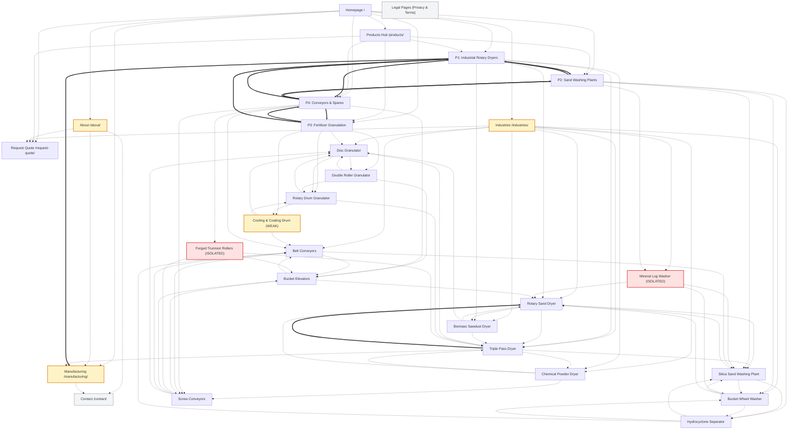
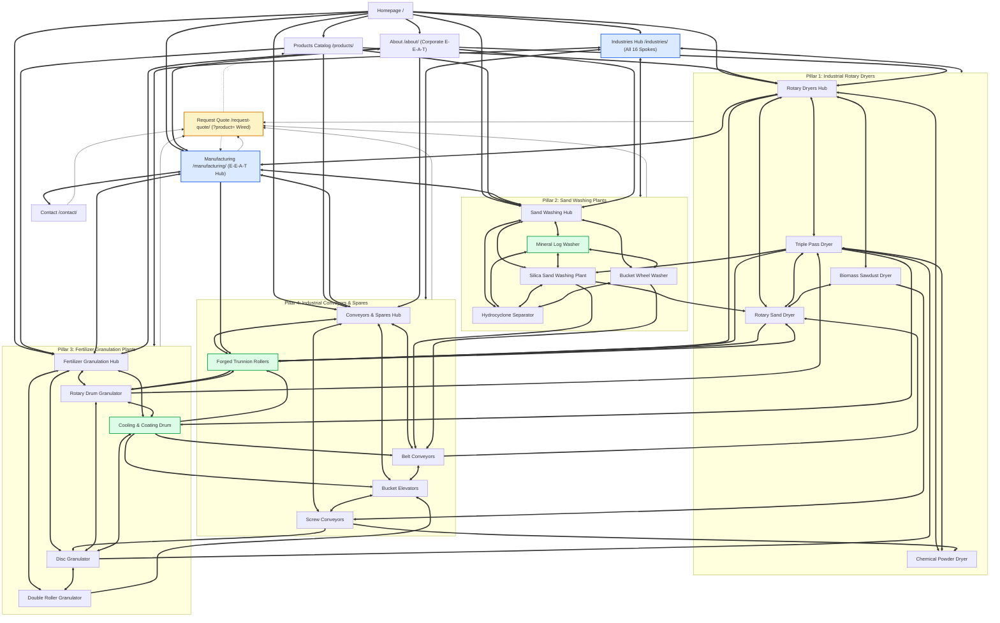
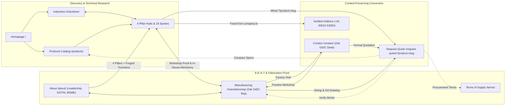

# Minerals Solutions — Internal Linking Architecture & Relationship Matrices

**Project:** Minerals Solutions (`https://mineralssolution.in/`)  
**Scope:** Current vs. Recommended Page-Body Internal Linking Graph across all 29 routes, Complete Product-to-Product Relationship Matrix, Industry-to-Machinery Relationship Matrix, and E-E-A-T / Conversion Funnel Architecture.

---

## 1. Current Internal Linking Graph (Page-Body Links Only)

> [!NOTE]
> Global chrome links (Header mega-menu = 33 links/page, Footer = 14 links/page, StickyBar = 1 link/page) are omitted below so the **true page-body topical structure** and structural bottlenecks are clearly visible. Dotted lines (`-.->`) indicate card/CTA-only links; solid thick lines (`==>`) indicate existing contextual body links (only 11 product/manufacturing links exist sitewide).

### Structural Diagnosis of Current Graph
1. **Zero Orphan Pages (thanks to Header/Footer), but 2 Severely Isolated Machinery Spokes:**
   - `forged-trunnion-rollers` (`TR`) has **0 incoming links** from siblings (`BC`, `BEL`, `SC`), **0 incoming links** from all 5 Rotary Dryer pages, **0 incoming links** from all 5 Fertilizer pages, **0** from `/manufacturing/`, and **0** from `/industries/`.
   - `mineral-log-washer` (`LW`) has **0 incoming links** from siblings (`SWP`, `BWW`, `FSR`) and **0** cross-pillar links.
2. **22 of 29 Pages (75.9%) Receive Zero Contextual Body Links:** All 16 spokes except `sand-dryer/` depend entirely on Header mega-menu and bottom card widgets.
3. **E-E-A-T Dead-Ends:** `/manufacturing/` and `/about/` are terminal sinks with **0** outbound links into the product catalog.
4. **One-Way Industry Hub:** `/industries/` links to only 8 of 16 spokes (0 pillars) and receives **0** reciprocal links from any product page.
5. **Broken Conversion Handoff:** All 69 CTA links + 5 spec-table links funnel into `/request-quote/`, where `?product=` is discarded and there are **0** links back to machinery specs or `/manufacturing/`.
6. **Redundant Outgoing Links:** Every spoke page emits 33 Header links + 14 Footer links + 1 StickyBar link + 9 triple-duplicated card links + 3 breadcrumbs + 1 hub link + 2–4 CTAs = **63–67 outgoing internal links per page**, while emitting **0–2 contextual body links**.

---

## 2. Recommended Hub-and-Spoke + Industrial Process-Flow Architecture

The target architecture preserves the clean 4-pillar Hub-and-Spoke hierarchy while adding **three engineering-authentic contextual layers**:
1. **Process-Chain Cross-Pillar Loops:** Wet Sand Washing → Belt Conveying → Rotary Sand/Triple-Pass Drying; Fertilizer Granulation → Rotary Drying → Cooling & Coating → Bucket Elevating / Belt Conveying; All Rotating Drums → Forged Trunnion Rollers & Girth Gears.
2. **Bidirectional E-E-A-T Trust Mesh:** Every product cluster links to `/manufacturing/` (Zak GIDC fabrication proof), while `/manufacturing/` and `/about/` link contextually out to the machinery fabricated in-house.
3. **Bidirectional Industry & Context-Preserving RFQ Layer:** `/industries/` connects all 9 sectors to all 16 spokes + 4 pillars; key product application sections link back to `/industries/`; `/request-quote/` preserves `?product=` pre-selection and links back to specs + `/manufacturing/` + `/contact/`.

---

## 3. Complete Product-to-Product Relationship Matrix

Every relationship below is verified against actual published pages and real mechanical/process workflows at Minerals Solutions (no unbuilt pages or speculative equipment).

| # | Source Page | Destination Page | Engineering / Process Relationship | Exact Placement | Recommended Anchor Text | Reciprocal Useful? |
|---|---|---|---|---|---|---|
| 1 | `/products/industrial-rotary-dryers/` | `/products/sand-washing-plants/` | Wet washed silica sand (12%–15% moisture) feeds directly into rotary dryers. | Process Overview (`L366`) — *already linked* | `sand washing plants` | **Yes** (`sand-washing-plants/` → `industrial-rotary-dryers/` & `sand-dryer/`) |
| 2 | `/products/industrial-rotary-dryers/` | `/products/industrial-conveyors-spares/belt-conveyors/` | Dried hot mineral discharge requires HR/SHR troughed belt conveyors to screening silos. | Process Overview (`L370`) — *refine from pillar to spoke* | `troughed belt conveyors` | **Yes** (`belt-conveyors/` L690 → `sand-dryer/`) |
| 3 | `/products/industrial-rotary-dryers/` | `/products/industrial-conveyors-spares/forged-trunnion-rollers/` | All rotary dryer drums ride on forged EN-8/EN-9/42CrMo4 trunnion rollers hardened to 280–320 BHN. | Spec Table (`L110`) + FAQ #3 | `support trunnion rollers` | **Yes** (`forged-trunnion-rollers/` L615 → `sand-dryer/` & `triple-pass-dryer/`) |
| 4 | `/products/industrial-rotary-dryers/triple-pass-dryer/` | `/products/industrial-rotary-dryers/sand-dryer/` | Single-pass sand dryer handles >30mm rocks or sticky clay better than concentric 3-pass clearances. | Engineering Selection Advice (`L745`) — *already linked* | `single-pass Industrial Sand Dryer` | **Yes** (card + selection comparison) |
| 5 | `/products/industrial-rotary-dryers/triple-pass-dryer/` | `/products/sand-washing-plants/silica-sand-washing-plant/` | High-clay river sand must be washed/deslimed before entering narrow concentric triple-pass drums. | FAQ #3 + Bottom Related Card | `Sand Washing Plant` | **Yes** (washed glass/foundry sand dries in 3-pass or single-pass dryers) |
| 6 | `/products/industrial-rotary-dryers/triple-pass-dryer/` | `/products/industrial-rotary-dryers/chemical-powder-dryer/` | Indirect shell-and-tube heating option for pure chemical/food-grade crystals. | FAQ #4 + Bottom Related Card | `chemical and food-grade mineral drying` | **Yes** (card + indirect vs. direct comparison) |
| 7 | `/products/industrial-rotary-dryers/triple-pass-dryer/` | `/products/industrial-conveyors-spares/forged-trunnion-rollers/` | Concentric 3-drum runout tolerances (<3mm) depend on forged 280–320 BHN trunnion rollers. | Fabrication & QA (`L830`) | `Solid forged alloy steel rollers` | **Yes** (`forged-trunnion-rollers/` links to `triple-pass-dryer/`) |
| 8 | `/products/industrial-rotary-dryers/sand-dryer/` | `/products/sand-washing-plants/bucket-wheel-sand-washer/` | Wet washed sand exiting bucket wheel washers enters the flash evaporation zone at ~14–16% moisture. | Drying Physics Stage 1 (`L550`) | `bucket washers` | **Yes** (`bucket-wheel-sand-washer/` card & discharge FAQ → `sand-dryer/`) |
| 9 | `/products/industrial-rotary-dryers/sand-dryer/` | `/products/industrial-conveyors-spares/belt-conveyors/` | Hot sand exiting at 80–150°C requires EPDM/HR rubber troughed belt conveyors. | Proposed addition (`L772`) | `heat-resistant troughed belt conveyors` | **Yes** (`belt-conveyors/` L690 → `sand-dryer/`) |
| 10 | `/products/industrial-rotary-dryers/sand-dryer/` | `/products/industrial-conveyors-spares/forged-trunnion-rollers/` | Abrasive 24/7 sand drying shells ride on forged alloy trunnion rollers and split girth gears. | FAQ #3 + Proposed addition (`L772`) | `forged trunnion support rollers` | **Yes** (`forged-trunnion-rollers/` L615 → `sand-dryer/`) |
| 11 | `/products/industrial-rotary-dryers/biomass-sawdust-dryer/` | `/products/industrial-conveyors-spares/screw-conveyors/` | Enclosed tubular screw feeder meters combustible sawdust into the dryer without back-spill or dust blowback. | Process Step 1 (`L207`) + FAQ #5 | `Tubular screw feeder` / `screw conveyor feed` | **Yes** (`screw-conveyors/` L465 → `industrial-rotary-dryers/`) |
| 12 | `/products/industrial-rotary-dryers/biomass-sawdust-dryer/` | `/products/industrial-conveyors-spares/belt-conveyors/` | Inclined belt conveyor with cross-belt magnet feeds wood chips/bagasse into biomass dryers. | Process Step 1 (`L207`) | `inclined belt conveyor` | **No** (optional — biomass is a secondary use case for quarry belts) |
| 13 | `/products/industrial-rotary-dryers/chemical-powder-dryer/` | `/products/industrial-conveyors-spares/screw-conveyors/` | Sanitary SS304/316 mirror-polished screw conveyors handle dust-tight charging/discharging of chemical crystals. | Bottom Related Card + inline process ref | `SS304/316 enclosed screw conveyors` | **Yes** (`screw-conveyors/` L873 → `chemical-powder-dryer/`) |
| 14 | `/products/sand-washing-plants/` | `/products/sand-washing-plants/mineral-log-washer/` | High-clay quartz and mineral ores require attrition log washing prior to screening. | Feed Selection bullet (`L364`) | `intensive attrition log washers` | **Yes** (breadcrumb + hub back-link) |
| 15 | `/products/sand-washing-plants/` | `/products/sand-washing-plants/bucket-wheel-sand-washer/` | Standard river sand and M-Sand feeds use low-power bucket wheel dewatering. | Feed Selection bullet (`L364`) | `bucket wheel desliming` | **Yes** (breadcrumb + hub back-link) |
| 16 | `/products/sand-washing-plants/` | `/products/sand-washing-plants/hydrocyclone-sand-separator/` | Captures 75–150 micron fine sand lost in bucket wheel overflow slurry. | Feed Selection bullet (`L368`) | `Polyurethane hydrocyclone circuits` | **Yes** (breadcrumb + hub back-link) |
| 17 | `/products/sand-washing-plants/` | `/products/industrial-conveyors-spares/belt-conveyors/` | Dewatered sand (12–14% moisture) moves directly via M24 troughed belt conveyor to stockpile or dryer. | Overview (`L350`) + FAQ #3 | `heavy belt conveyors` / `trough belt conveyor` | **Yes** (`belt-conveyors/` L531 → `sand-washing-plants/`) |
| 18 | `/products/sand-washing-plants/silica-sand-washing-plant/` | `/products/sand-washing-plants/mineral-log-washer/` | Twin-shaft log washer is Stage 1 of the silica plant, shearing Fe2O3 iron-clay films off quartz crystals. | Hero (`L351`) + FAQ #2 | `twin-shaft attrition log washers` / `twin-shaft log washer` | **Yes** (`mineral-log-washer/` links to `silica-sand-washing-plant/`) |
| 19 | `/products/sand-washing-plants/silica-sand-washing-plant/` | `/products/sand-washing-plants/hydrocyclone-sand-separator/` | Hydrocyclone cluster is Stage 2–3, ejecting -75µm iron slimes while recovering +75µm glass sand. | Hero (`L351`) + FAQ #2 | `polyurethane hydrocyclone desliming` / `downstream hydrocyclone` | **Yes** (`hydrocyclone-sand-separator/` links to `silica-sand-washing-plant/`) |
| 20 | `/products/sand-washing-plants/silica-sand-washing-plant/` | `/products/industrial-rotary-dryers/sand-dryer/` | Automated Wash-and-Dry line feeds 12–14% dewatered silica sand straight into the rotary sand dryer. | FAQ #5 + Bottom Related Card | `Industrial Rotary Sand Dryer` | **Yes** (`sand-dryer/` links to `silica-sand-washing-plant/`) |
| 21 | `/products/sand-washing-plants/hydrocyclone-sand-separator/` | `/products/sand-washing-plants/mineral-log-washer/` | Hydrocyclones retrofit directly onto mineral log washer overflow weirs to recover +75µm fine sand. | Engineering Intro (`L452`) + FAQ #5 | `log washers` | **Yes** (`mineral-log-washer/` FAQ #6 → `hydrocyclone-sand-separator/`) |
| 22 | `/products/sand-washing-plants/hydrocyclone-sand-separator/` | `/products/sand-washing-plants/bucket-wheel-sand-washer/` | Over 60% of hydrocyclone units retrofit onto existing bucket wheel sand washer overflow launders. | Engineering Intro (`L452`) + FAQ #5 | `bucket wheels` / `bucket wheel washers` | **Yes** (`bucket-wheel-sand-washer/` FAQ #5 → `hydrocyclone-sand-separator/`) |
| 23 | `/products/fertilizer-granulation-plants/` | `/products/fertilizer-granulation-plants/fertilizer-cooling-coating-drum/` | Cooling and anti-caking coating is mandatory downstream of fertilizer drying to prevent warehouse caking. | Hero (`L338`) + FAQ #3 | `rotary cooling and conditioning drums` | **Yes** (breadcrumb + hub back-link) |
| 24 | `/products/fertilizer-granulation-plants/disc-granulator/` | `/products/industrial-rotary-dryers/triple-pass-dryer/` | Wet green compost/NPK granules (16%–32% moisture) require gentle downstream rotary drying to <10%. | FAQ #3 + Bottom Related Card | `downstream rotary drum dryer` | **Yes** (`industrial-rotary-dryers/` / `biomass-sawdust-dryer/` → `disc-granulator/`) |
| 25 | `/products/fertilizer-granulation-plants/disc-granulator/` | `/products/fertilizer-granulation-plants/fertilizer-cooling-coating-drum/` | Dried spherical granules must be cooled <40°C and neem/talc coated before 50kg bagging. | Proposed addition (`L706`) | `rotary cooling and anti-caking coating drum` | **Yes** (`fertilizer-cooling-coating-drum/` links to `disc-granulator/`) |
| 26 | `/products/fertilizer-granulation-plants/double-roller-granulator/` | `/products/industrial-conveyors-spares/bucket-elevators/` | Closed-loop dry compaction relies on a vertical bucket elevator to recycle screened undersize fines (0% waste). | Circuit Step 4 (`L748`) + FAQ #5 | `bucket elevator` | **Yes** (`bucket-elevators/` L289 → `fertilizer-granulation-plants/` or `double-roller-granulator/`) |
| 27 | `/products/fertilizer-granulation-plants/rotary-drum-granulator/` | `/products/fertilizer-granulation-plants/fertilizer-cooling-coating-drum/` | Stage 3 & 4 of every turnkey NPK drum granulation circuit is rotary cooling and anti-caking coating. | Circuit Step 4 (`L722`) + FAQ #6 | `Coating drum` / `Rotary Coating Drum` | **Yes** (`fertilizer-cooling-coating-drum/` links to `rotary-drum-granulator/`) |
| 28 | `/products/fertilizer-granulation-plants/rotary-drum-granulator/` | `/products/industrial-conveyors-spares/forged-trunnion-rollers/` | Heavy 3–20 TPH drum granulators run 24/7 on forged riding tyres, spherical trunnions, and Module 24 girth gears. | Features (`L160`) + Spec Table (`L279`) + FAQ #5 | `spherical roller bearing trunnions` / `Support trunnions` | **Yes** (`forged-trunnion-rollers/` L615 → `rotary-drum-granulator/`) |
| 29 | `/products/fertilizer-granulation-plants/fertilizer-cooling-coating-drum/` | `/products/industrial-rotary-dryers/` | Receives hot granules directly from rotary drying drums at 75°C–85°C. | FAQ #1 | `rotary drying drum` | **Yes** (`fertilizer-granulation-plants/` & `rotary-drum-granulator/` bridge both) |
| 30 | `/products/fertilizer-granulation-plants/fertilizer-cooling-coating-drum/` | `/products/industrial-conveyors-spares/bucket-elevators/` | Conditioned pellets discharge gently into continuous packaging bucket elevators to prevent crushing. | Process Stage 4 (`L720`) | `packaging elevator` | **Yes** (continuous non-crushing fertilizer elevator duty) |
| 31 | `/products/fertilizer-granulation-plants/fertilizer-cooling-coating-drum/` | `/products/industrial-conveyors-spares/forged-trunnion-rollers/` | Conditioning drums rotate continuously on heavy trunnion support rollers and thrust rollers. | Fabrication Quality (`L947`) | `trunnion rollers mounted on spherical roller bearings` | **Yes** (running gear compatibility) |
| 32 | `/products/industrial-conveyors-spares/` | `/products/industrial-conveyors-spares/forged-trunnion-rollers/` | Parent pillar introduces aftermarket forged trunnion rollers and split girth gears for rotary equipment. | Overview (`L377`) + Metallurgy intro (`L471`) + FAQ #1 | `forged replacement trunnion support rollers and split girth gears` | **Yes** (breadcrumb + hub back-link) |

---

## 4. Industry-to-Machinery Relationship Matrix (`/industries/` Coverage)

Currently `/industries/` links to **only 8 unique spokes** (0 pillars), omitting 8 published equipment pages. The matrix below maps all **9 verified sectors** on `/industries/` to their genuine primary and secondary equipment destinations:

| # | Verified Sector on `/industries/` | Currently Linked URL | Missing Genuine Machinery Connections to Add | Reciprocal Product → `/industries/` Source |
|---|---|---|---|---|
| 1 | **Ceramic Tiles & Raw Mineral Body Preparation (Morbi Cluster)** | `sand-dryer/` | `mineral-log-washer/`, `belt-conveyors/`, `industrial-rotary-dryers/` | `sand-dryer/` (Morbi tile/quartz section) |
| 2 | **Silica Sand & Foundry Sand Processing** | `sand-dryer/` *(duplicate of Sector 1!)* | `silica-sand-washing-plant/`, `triple-pass-dryer/`, `sand-washing-plants/` | `silica-sand-washing-plant/` & `triple-pass-dryer/` |
| 3 | **NPK & Organic Bio-Fertilizer Plants** | `disc-granulator/` | `fertilizer-cooling-coating-drum/`, `rotary-drum-granulator/`, `double-roller-granulator/`, `fertilizer-granulation-plants/` | `disc-granulator/` & `rotary-drum-granulator/` |
| 4 | **River Sand & Aggregate Washing** | `bucket-wheel-sand-washer/` | `hydrocyclone-sand-separator/`, `sand-washing-plants/` | `bucket-wheel-sand-washer/` & `hydrocyclone-sand-separator/` |
| 5 | **Chemical Salts & Inorganic Crystals** | `chemical-powder-dryer/` | `screw-conveyors/` (SS304/316 sanitary augers), `industrial-rotary-dryers/` | `chemical-powder-dryer/` (Ankleshwar/Dahej corridor) |
| 6 | **Biomass & Sawdust Pelletizing** | `biomass-sawdust-dryer/` | `triple-pass-dryer/`, `screw-conveyors/` (tubular feeder) | `biomass-sawdust-dryer/` |
| 7 | **Fly Ash, Slag & Gypsum Processing** | `triple-pass-dryer/` | `forged-trunnion-rollers/`, `belt-conveyors/`, `screw-conveyors/` (fly ash enclosed) | `forged-trunnion-rollers/` |
| 8 | **Quartz Stone & Mineral Beneficiation** | `mineral-log-washer/` | `hydrocyclone-sand-separator/` (weir slurry recovery), `silica-sand-washing-plant/` | `mineral-log-washer/` (quartz/ferrosilicon/bauxite) |
| 9 | **Bulk Material Handling & Quarry Logistics** | `belt-conveyors/` | `bucket-elevators/`, `screw-conveyors/`, `industrial-conveyors-spares/` | `belt-conveyors/` & `bucket-elevators/` |

*Result:* Expands `/industries/` coverage from **8 of 16 spokes (50%) and 0 of 4 pillars (0%)** to **16 of 16 spokes (100%) and 4 of 4 pillars (100%)**, backed by reciprocal industry links from key equipment pages.

---

## 5. E-E-A-T & Conversion Funnel Integration Architecture

### Target Post-Implementation Benchmarks

| Metric | Current Baseline | Post-Implementation Target |
|---|---|---|
| True contextual body links (all 29 pages) | **16** (11 product/mfg + 5 spec RFQ) | **85 – 105** (natural 3–6 per key page) |
| Pages with 0 contextual incoming links | **22 of 29 (75.9%)** | **2 of 29** (legal pages only, or **0**) |
| Spokes with contextual incoming links | **1 of 16 (6.3%)** | **16 of 16 (100%)** |
| FAQ answers with contextual internal links | **0 of 103 (0%)** | **18 – 22** (high-value engineering FAQs only) |
| `/manufacturing/` & `/about/` outbound product links | **0** | **10+** (all 4 pillars + key forged/machined spokes) |
| `/industries/` unique machinery spokes linked | **8 of 16 (50%)** | **16 of 16 (100%) + 4 pillars** |
| Product RFQ links preserving `?product=` in form | **0%** (ignored by `RequestQuoteClient`) | **100%** (via `useSearchParams()`) |
| Spoke pages with wrong `tel:+919227004455` | **5 pages** | **0 pages** |
| Broken hash targets in `next.config.ts` redirects | **4 redirects** | **0 redirects** |
