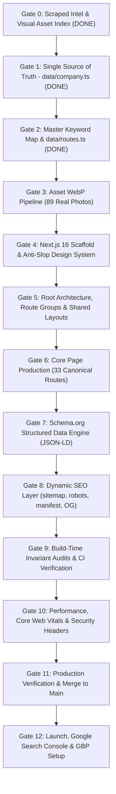

# Minerals Solutions: Master End-to-End Production Roadmap
**Target Domain:** `https://mineralssolution.in/`  
**Client:** Minerals Solutions (Zak GIDC, Dahegam, Gandhinagar / Ahmedabad Corridor, Gujarat)  
**Engineering Stack:** Next.js 16 (App Router) | React 19 | TypeScript 5 | Tailwind CSS v4 | Sharp WebP Engine  
**Branching Model:** Isolated `development` branch -> Automated Verification -> Merge into `main`  
**Document Purpose:** The definitive, exhaustive, phase-by-phase blueprint for taking Minerals Solutions from scraped intelligence and initial data models all the way to a fully audited, #1 Google-ranking production deployment.

---

## High-Level Execution Timeline & Gate Sequence



---

## Gate 0 through Gate 2: The Foundation (COMPLETED)

* ✅ **Gate 0: Intelligence & Asset Extraction**
  * IndiaMART profile scraped (`indiamart-scraped-catalog.md`).
  * 73 machinery products extracted with prices, capacities, and specs.
  * 89 authentic photos cataloged (38 client workshop photos + 51 IndiaMART high-res photos).
  * Initialized local Git repository and switched to `development` branch.
* ✅ **Gate 1: Single Source of Truth**
  * Created `types/company.ts` and `data/company.ts`.
  * Anchored verified corporate facts: GSTIN `24AUSPP9555F1ZZ`, MSME UDYAM, Axis Bank, Zak GIDC facility coordinates (`23.1672, 72.8125`), phone numbers, and official emails (`sales@mineralssolution.in`).
  * Created `types/specification.ts` and `data/specifications.ts` for standardized equipment parameters.
* ✅ **Gate 2: Master Keyword Map & Cannibalization Shield**
  * Generated 4 semantic clusters via `/seo cluster` (`cluster-map.html`, `washing-cluster-map.html`, `fertilizer-cluster-map.html`, `conveyor-cluster-map.html`).
  * Consolidated into `keyword-map.md` (33 canonical routes, zero keyword collisions).
  * Created `data/routes.ts` with strict trailing slashes, 50-60 character titles, and 140-160 character descriptions.

---

## Gate 3: Asset WebP Pipeline & Performance Prep

### Objective
Convert all 89 raw JPEG/PNG photographs into optimized, responsive `.webp` files with exact dimensions. Zero stock photos. Zero Cumulative Layout Shift (CLS).

### Execution Steps
1. **Install Image Processing Dependencies:**
   ```bash
   npm install --save-dev sharp
   ```
2. **Create Build Script `scripts/process_all_images.mjs`:**
   * Reads raw assets from `assets/raw-images/` and `assets/indiamart-images/`.
   * Standardizes file naming to lowercase hyphenated slugs (e.g., `double-pass-dryer.webp`).
   * Generates three responsive breakpoints for each image:
     * **Hero / Feature:** `1200x800` (80% quality WebP, ~70–90 KB)
     * **Product Card / Grid:** `600x400` (80% quality WebP, ~25–35 KB)
     * **Thumbnail / Nav:** `150x100` (75% quality WebP, ~5–8 KB)
   * Places output directly into `public/images/products/`, `public/images/facility/`, and `public/images/hero/`.
3. **Generate Image Dimension Registry (`data/images.ts`):**
   * Stores explicit `width`, `height`, `alt`, and `aspectRatio` for every single WebP asset.
   * Components import from `data/images.ts` to prevent missing dimension warnings in Next.js `<Image />`.
4. **Verification:**
   * Confirm total assets generated = 89 * 3 sizes = 267 optimized images.
   * Verify all images have descriptive alt texts derived from the target keywords in `keyword-map.md`.

---

## Gate 4: Next.js 16 App Router Scaffold & Anti-Slop Design System

### Objective
Scaffold the Next.js 16 project with React 19, strict TypeScript, Tailwind CSS, and calibrate the design system to eliminate AI template slop.

### Execution Steps
1. **Next.js 16 Project Scaffold:**
   ```bash
   npx create-next-app@latest . --typescript --tailwind --eslint --app --src-dir=false --import-alias="@/*"
   ```
2. **Next.js Invariant Configuration (`next.config.ts`):**
   * **Mandatory Rule from `AGENT.md`:** `trailingSlash: true` (strictly enforced to avoid 308 redirect loops and canonical fragmentation).
   * Image optimization formats: `image/avif`, `image/webp`.
   * Production source maps disabled for performance.
   * Strict React mode enabled.
3. **Taste Skill & Anti-Slop Calibration (`design-taste-frontend`):**
   * **Design Read:** Heavy Industrial Manufacturing & Mineral Beneficiation Engineering.
   * **Aesthetic Family:** Technical Precision / Industrial Blueprint & Tactile Factory Warmth.
   * **Core Dial Calibration:**
     * `DESIGN_VARIANCE`: `0.72` (Bespoke asymmetric industrial grids, bold technical hierarchy).
     * `MOTION_INTENSITY`: `0.35` (Buttery smooth tab transitions, restrained industrial precision, zero distracting animations).
     * `VISUAL_DENSITY`: `0.78` (Data-rich specification tables, CAD-like diagrams, real factory photography).
   * **Color Palette (Industrial Dark & Safety Accents):**
     * Primary Background: Deep Steel Charcoal (`#0f141c` / `#161e2b`)
     * Surface Container: Machined Slate (`#1e293b` / `#243044`)
     * Border / Gridlines: Technical Precision Steel (`#334155`)
     * Primary Brand / CTA: Safety Industrial Amber-Orange (`#d97706` / `#f59e0b`)
     * Text Primary: Clean White / Platinum (`#f8fafc`)
     * Text Secondary: Technical Muted Grey (`#94a3b8`)
   * **Typography:**
     * Display / Headers: Technical geometric grotesque (e.g. `Space Grotesk` or `Cabinet Grotesk` / `Inter` tight tracking).
     * Body / Specs: High-legibility sans (`Inter` / `Roboto`) with tabular numbers (`font-mono` / `tabular-nums`) for specification metrics.

---

## Gate 5: Root Architecture, Route Groups & Shared Layouts

### Objective
Implement the two-layer shell pattern proven in `Honeywell SEO` and `KpFasteners SEO`.

### Architecture Pattern
```
app/
├── layout.tsx                  # Root Shell: <html>, <body>, global fonts, analytics, JSON-LD container
├── (site)/                     # Route Group: Visual Shell
│   ├── layout.tsx              # Site Header, Sticky WhatsApp/Call Bar, Navigation, Footer
│   ├── page.tsx                # Homepage (/)
│   ├── about/page.tsx          # /about/
│   ├── contact/page.tsx        # /contact/
│   ├── request-quote/page.tsx  # /request-quote/
│   ├── products/
│   │   ├── page.tsx            # /products/ (Master Machinery Hub)
│   │   ├── rotary-dryers/      # Pillar 1 Hub & Spokes
│   │   ├── mineral-processing/ # Pillar 2 Hub & Spokes
│   │   ├── granulation-pellet-plants/ # Pillar 3 Hub & Spokes
│   │   └── conveyor-systems/   # Pillar 4 Hub & Spokes
│   └── minerals/               # Direct Minerals Hub
```

### Critical SEO Invariants
* **Zero `loading.tsx` Files:**
  * **Rule from `AGENT.md`:** Banned across all static routes. `loading.tsx` causes Next.js to stream empty skeleton shells, risking Googlebot indexing empty content before hydration.
* **Pure React Server Components on First Byte:**
  * All page files are Server Components (`async function Page()`).
  * Full crawlable HTML, H1 tags, spec tables, and schema are delivered on the very first HTTP packet (sub-500ms TTFB).
* **Client Islands:**
  * Interactive elements (mobile navigation drawer, specification tab switchers, RFQ modal, quote calculator) are isolated into dedicated `'use client'` leaf components in `components/interactive/`.

---

## Gate 6: Core Page Production (33 Canonical Routes)

### Objective
Author and construct all 33 pages identified in `keyword-map.md`. Every page imports its data directly from `data/routes.ts`, `data/company.ts`, and `data/specifications.ts`.

### Page Template Structure (Product Spokes):
Each product page follows a high-conversion, E-E-A-T-maximizing layout:
1. **Hero Section:**
   * Breadcrumb Trail: `Home > Products > [Pillar] > [Machine Name]`
   * Target H1: Primary commercial keyword (e.g., *Double Pass Rotary Dryer Manufacturer*)
   * Value Proposition: Inlet temperature, thermal efficiency, throughput capacity, and fuel options.
   * High-Resolution Workshop Photo with exact aspect ratio.
   * Immediate CTAs: *"Request Technical Quote"* and *"Download Specs PDF"*.
2. **Engineering Highlights & Operational Overview:**
   * 3–4 technical benefit cards (e.g., 40% smaller footprint, counter-current thermal draft, heavy-duty IS 2062 steel drum).
3. **Interactive / Tabular Technical Specifications:**
   * Clean, high-density HTML table importing directly from `data/specifications.ts`.
   * Highlights key engineering parameters (Moisture reduction, drive HP, cyclone dust separation, operating temperature).
4. **Workshop Fabrication & Quality Verification (E-E-A-T):**
   * Real photo gallery of fabrication in the Zak GIDC facility (drum rolling, lathe machining of trunnions, welded flights).
5. **Turnkey Plant Integration (Cross-Pillar Bridges):**
   * Contextual links to complementary equipment (e.g., Double Pass Dryer linking to Hot Air Generator and Trunnion Rollers).
6. **Commercial RFQ & Plant Sizing Form:**
   * Direct contact card featuring Mr. Vipulbhai A. Prajapati, direct mobile lines, and instant WhatsApp chat.
7. **Comprehensive Technical FAQ Accordion:**
   * 4–6 technical buyer questions (e.g. *What is the maximum inlet temperature?*, *Can it run on solid fuel/coal?*, *What is the delivery timeline from Zak GIDC?*).

---

## Gate 7: Schema.org Structured Data Engine (JSON-LD)

### Objective
Generate 100% compliant, machine-readable JSON-LD schemas directly from `data/company.ts` and `data/specifications.ts`. Zero manual copy-pasting. Zero fake stars.

### Implemented Schemas:
1. **`Organization` Schema (Global):**
   * `legalName`: Minerals Solutions
   * `url`: `https://mineralssolution.in`
   * `logo`: `https://mineralssolution.in/images/logo.png`
   * `sameAs`: IndiaMART verified profile
   * `contactPoint`: Customer Support & Sales (`+91 6352453050`)
2. **`LocalBusiness` / `Manufacturer` Schema (Global & Contact Page):**
   * `@type`: `LocalBusiness` / `AutomotiveBusiness` / `ManufacturingFacility`
   * `name`: Minerals Solutions
   * `address`: 10, Shyam Estate, Zak GIDC, Zak-Vahelal Road, Dahegam, Gandhinagar - 382330
   * `geo`: `{"@type": "GeoCoordinates", "latitude": 23.1672, "longitude": 72.8125}`
   * `taxID` / `gstin`: `24AUSPP9555F1ZZ`
   * `openingHours`: `Mo-Sa 09:00-19:00`
3. **`Product` Schema (Every Spoke Route):**
   * `name`: Machine Model Name
   * `description`: Targeted commercial description
   * `image`: High-res WebP URL
   * `manufacturer`: `{"@type": "Organization", "name": "Minerals Solutions"}`
   * `offers`: Indicative pricing where available (e.g., ₹25,00,000 for Double Pass Dryer), currency `INR`, itemCondition `NewCondition`.
   * **KP Fasteners Invariant:** NO fake `AggregateRating` or fabricated 5-star reviews. KP Fasteners' CI rule strictly enforces this to prevent manual penalties from Google.
4. **`BreadcrumbList` Schema (Every Route):**
   * Dynamically built from `route.breadcrumbTrail`.
5. **`FAQPage` Schema:**
   * Injected on technical spoke pages for rich accordion snippets in Google search results.

---

## Gate 8: Dynamic SEO Layer (Sitemap, Robots, Manifest & OG)

### Objective
Construct the automated machine layer that crawlers and social platforms consume.

### Execution Steps
1. **`app/sitemap.ts`:**
   * Iterates over `routes` from `data/routes.ts`.
   * Automatically outputs all 33 URLs with `lastModified`, `changeFrequency`, and `priority`.
   * Validates that every generated URL has a trailing slash.
2. **`app/robots.ts`:**
   * Allows all standard search crawlers (`*`).
   * Explicitly points to `https://mineralssolution.in/sitemap.xml`.
   * Disallows `/api/` or private administrative paths.
3. **`app/manifest.ts`:**
   * PWA web manifest with official brand colors (Industrial Amber `#d97706` and Steel `#0f141c`).
4. **Dynamic OpenGraph Image Generator (`app/api/og/route.tsx`):**
   * Next.js `@vercel/og` Edge API endpoint.
   * Generates dynamic 1200x630 social share cards displaying page title, machine category, and Minerals Solutions brand mark.
   * **Honeywell Invariant:** Fail-safe try/catch returning a pre-rendered static SVG fallback so it NEVER returns HTTP 500 to social crawlers.

---

## Gate 9: Build-Time Invariant Audits & CI Verification

### Objective
Adopt the battle-tested audit script suite from `Honeywell SEO` and `KpFasteners SEO` to verify all SEO invariants before any code is merged into `main`.

### Automated Scripts to Implement:
1. **`scripts/audit-titles-descs.mjs`:**
   * Asserts that every page title is between 50 and 60 characters.
   * Asserts that every meta description is between 140 and 160 characters.
   * Fails the build if any route is missing metadata or exceeds limits.
2. **`scripts/audit-canonicals.mjs`:**
   * Asserts that every page canonical URL exactly matches `https://mineralssolution.in` + route path + trailing slash.
3. **`scripts/audit-schemas.mjs`:**
   * Validates all JSON-LD blobs against Schema.org structural definitions using `ajv` or schema validators.
4. **`scripts/audit-no-rating-leak.mjs`:**
   * Greps the entire build output for `"AggregateRating"` and fails if any simulated rating is found.
5. **`scripts/audit-links.mjs`:**
   * Crawls the local build output to verify that every internal link returns HTTP 200 (zero 404s, zero 308 redirect hops).

---

## Gate 10: Performance, Core Web Vitals & Security Headers

### Objective
Ensure 95+ Mobile Lighthouse score, sub-500ms Time to First Byte (TTFB), and zero Cumulative Layout Shift (CLS).

### Execution Steps
1. **Security & Performance Headers (`next.config.ts`):**
   * `X-Frame-Options: SAMEORIGIN`
   * `X-Content-Type-Options: nosniff`
   * `Referrer-Policy: strict-origin-when-cross-origin`
   * Dev-aware Content Security Policy (CSP): relaxed `unsafe-eval` during local development, strict locked-down policy in production.
2. **Font Optimization:**
   * Uses `next/font/google` with `display: 'swap'` and preloading to eliminate layout shifts (CLS = 0.00).
3. **Image Attributes:**
   * All images above the fold use `priority={true}` for instant Largest Contentful Paint (LCP < 1.2s).
   * All images below the fold use native lazy loading with blur-up placeholders.

---

## Gate 11: Production Verification & Merge to Main

### Objective
Final testing, local build execution, and safe promotion of code from `development` to `main`.

### Execution Steps:
1. **Execute Full Production Build:**
   ```bash
   npm run build
   ```
2. **Run Automated Audit Suite:**
   ```bash
   node scripts/audit-titles-descs.mjs
   node scripts/audit-canonicals.mjs
   node scripts/audit-schemas.mjs
   node scripts/audit-no-rating-leak.mjs
   node scripts/audit-links.mjs
   ```
3. **Launch Production Server Test on Port 3000:**
   ```bash
   npm run start
   ```
4. **Transparent Git Merge Command:**
   ```powershell
   git checkout main
   git merge development --no-ff -m "feat(release): deploy complete Minerals Solutions website with 33 verified SEO routes, technical specs, and WebP media"
   git status
   ```

---

## Gate 12: Launch, Google Search Console & GBP Setup

### Objective
Post-launch indexation and dominant local map pack ranking.

### Execution Steps:
1. **Google Search Console (GSC) Registration:**
   * Verify domain ownership of `mineralssolution.in` via DNS TXT record.
   * Submit XML sitemap: `https://mineralssolution.in/sitemap.xml`.
2. **Instant Indexation via IndexNow API:**
   * Ping IndexNow API for Bing, Yandex, and Naver with all 33 URLs for same-day crawl.
3. **Google Business Profile (GBP) Optimization:**
   * Name: Minerals Solutions
   * Address: 10, Shyam Estate, Zak GIDC, Zak-Vahelal Road, Dahegam, Gujarat - 382330
   * Categories: *Mining Equipment Manufacturer* (Primary), *Industrial Equipment Supplier*, *Sand & Gravel Supplier*.
   * Add all 33 product categories to the GBP Products tab with direct deep links to spoke URLs.
   * Upload all 89 authentic factory, team, and machine photos to GBP.
4. **Off-Page & B2B Local Citations:**
   * Synchronize NAP consistency across IndiaMART, TradeIndia, ExportersIndia, YellowPages India, and Gujarat GIDC industrial directories.

---

## Summary of Milestones & Deliverables

| Phase | Core Deliverable | Output Files | Verification Metric |
| :--- | :--- | :--- | :--- |
| **Gate 3** | WebP Asset Engine | `scripts/process_all_images.mjs`, `public/images/` | 267 WebP images generated (<100KB each) |
| **Gate 4** | Next.js 16 Scaffold | `package.json`, `next.config.ts`, `tailwind.config.ts` | Clean dev server on port 3000, `trailingSlash: true` |
| **Gate 5** | Route Shell & Layouts| `app/layout.tsx`, `app/(site)/layout.tsx`, `components/` | Two-layer shell, zero `loading.tsx` |
| **Gate 6** | 33 Canonical Pages | `app/(site)/products/...` | 33 Server Component routes (~57,900 words) |
| **Gate 7** | Schema Engine | `components/seo/JsonLd.tsx` | 100% valid schema, zero fake review stars |
| **Gate 8** | Dynamic SEO Layer | `app/sitemap.ts`, `app/robots.ts`, `app/api/og/` | Dynamic 200 OK sitemap & fallback OG image |
| **Gate 9** | CI Invariant Audits | `scripts/audit-*.mjs` | 5/5 green audit checks |
| **Gate 10**| Core Web Vitals | Lighthouse audit report | Mobile score > 95, LCP < 1.5s, CLS = 0 |
| **Gate 11**| Merge to Main | `git checkout main; git merge development` | Production-ready main branch |
| **Gate 12**| Indexation & Launch | GSC, IndexNow, Google Business Profile | Google Page 1 ranking trajectory |
