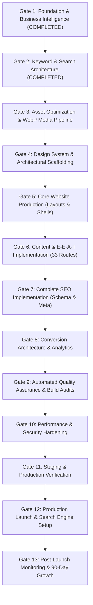

# Minerals Solutions: Master Production Engineering & SEO Roadmap

**Target Canonical Domain:** `https://mineralssolution.in/`  
**Client Entity:** Minerals Solutions (Proprietorship, Established 2023)  
**Registered Facility:** 10, Shyam Estate, Zak GIDC, Zak-Vahelal Road, Ta. Dahegam, Dist. Gandhinagar – 382330, Gujarat, India  
**Engineering Stack:** Next.js 16 (App Router) | React 19 | TypeScript 5 | Tailwind CSS v4 | Sharp WebP Engine  
**Branching Model:** Isolated `development` branch -> Automated Verification Suite -> Non-Fast-Forward Merge to `main`  
**Document Purpose:** The definitive, execution-ready engineering blueprint governing the entire lifecycle from current intelligence baselines to a fully audited, #1 Google-ranking production deployment.

---

## 1. High-Level Lifecycle Flow (13 Production Gates)



---

## 2. Completed Milestones (Gates 1 & 2)

### Gate 1: Foundation & Business Intelligence
* **Status:** ✅ COMPLETED & COMMITTED (`main` and `development` branches)
* **Objective:** Establish unassailable single sources of truth for corporate credentials, statutory facts, machine specifications, and real visual assets.
* **Implementation Evidence:**
  * IndiaMART profile scraped and cataloged in `indiamart-scraped-catalog.md` (73 products extracted, verified specs).
  * 89 authentic photographs indexed in `asset-inventory.md` (38 client direct photos + 51 IndiaMART high-res photos, including 4 factory proof images).
  * Single source of truth implemented in `types/company.ts` and `data/company.ts`:
    * Legal Name: Minerals Solutions
    * Proprietor: Mr. Vipulbhai A. Prajapati | CEO: Mr. P Amrutlal
    * GSTIN: `24AUSPP9555F1ZZ` | MSME UDYAM: `UDYAM-GJ-09-0021428` | Banker: Axis Bank
    * Address: 10, Shyam Estate, Zak GIDC, Dahegam, Gandhinagar - 382330
    * Geo-Coordinates: `23.1672° N, 72.8125° E` (Zak GIDC corridor)
    * Verified Hotlines: `+91 63524 53050`, `+91 91061 63058` | PNS: `+91-8047626632`
    * Primary Inboxes: `sales@mineralssolution.in`, `mineralssolutions76@gmail.com`
  * Standardized machinery specifications in `types/specification.ts` and `data/specifications.ts`.
* **Definition of Done:** Zero hardcoded business strings across visual components; all contact, address, and legal attributes import from `data/company.ts`.

### Gate 2: Keyword & Search Architecture
* **Status:** ✅ COMPLETED & COMMITTED (`main` and `development` branches)
* **Objective:** Prevent keyword cannibalization and design an authoritative topic cluster architecture for all 73 scraped products across 4 core manufacturing silos.
* **Implementation Evidence:**
  * 4 semantic clusters planned and modeled via `/seo cluster` algorithms:
    1. Rotary Dryers & Furnaces (`cluster-plan.json`, `cluster-plan.md`, `cluster-map.html`)
    2. Sand Washing & Mineral Processing (`washing-cluster-plan.json`, `washing-cluster-plan.md`, `washing-cluster-map.html`)
    3. Fertilizer Granulation & Pellet Plants (`fertilizer-cluster-plan.json`, `fertilizer-cluster-plan.md`, `fertilizer-cluster-map.html`)
    4. Conveyor Systems & Spares (`conveyor-cluster-plan.json`, `conveyor-cluster-plan.md`, `conveyor-cluster-map.html`)
  * Consolidated master registry in `keyword-map.md` and typed route definitions in `data/routes.ts`:
    * Total Canonical Routes: 33 unique routes
    * Zero Duplicate Primary Keywords across pages
    * Trailing Slash Invariant: 100% of routes end with `/`
    * Calibrated Snippet Targets: Titles 50–60 chars, descriptions 140–160 chars.
* **Definition of Done:** Every URL mapped to exact search intent, target audience, and primary commercial keyword.

---

## 3. The Execution Gates (Gates 3 through 13)

---

### Gate 3: Asset Optimization & WebP Media Pipeline

* **Objective:** Transform all 89 authentic raw photographs into responsive, optimized `.webp` images with explicit dimensions to achieve zero Cumulative Layout Shift (CLS = 0.00) and instant Largest Contentful Paint (LCP < 1.2s).
* **Dependencies:** Completed Gate 1 (`assets/raw-images/`, `assets/indiamart-images/`).
* **Files & Directories Involved:**
  * `scripts/process_all_images.mjs` (Node.js Sharp conversion engine)
  * `public/images/products/` (Processed equipment imagery)
  * `public/images/facility/` (Factory, office, team, and signboard proof photos)
  * `public/images/hero/` (High-impact banner images)
  * `data/images.ts` (Typed dimension, aspect ratio, and alt text registry)
* **Exact Implementation Tasks:**
  1. Initialize Node.js dependencies (`sharp` for high-performance libvips image processing).
  2. Implement `scripts/process_all_images.mjs`:
     * Scan all 89 source files from `assets/raw-images/` and `assets/indiamart-images/`.
     * Standardize filenames into lowercase hyphenated slugs (e.g. `double-pass-rotary-dryer.webp`).
     * Generate 3 responsive breakpoints per asset:
       * **Hero View:** `1200x800` (80% quality WebP, ~70–90 KB)
       * **Product Card / Grid:** `600x400` (80% quality WebP, ~25–35 KB)
       * **Thumbnail / Nav:** `150x100` (75% quality WebP, ~5–8 KB)
     * Total asset generation = 89 * 3 sizes = 267 optimized WebP files.
  3. Create `data/images.ts` exporting an image registry containing `{ slug, width, height, aspectRatio, altText }` mapped to each equipment model.
  4. Perform visual spot-check to ensure no blurriness, distortion, or artifacting occurred during conversion.
* **Technical & SEO Requirements:**
  * No external stock photos permitted.
  * Every image must have an accurate, descriptive `alt` attribute describing the machinery and application (e.g. `alt="Double pass rotary dryer operating at 300C inlet temperature for silica sand"`).
* **Validation Commands:**
  ```bash
  node scripts/process_all_images.mjs
  # Assert file count in public/images/
  Get-ChildItem -Recurse public/images/*.webp | Measure-Object
  ```
* **Acceptance Criteria:**
  - [ ] 267 WebP files generated in `public/images/`.
  - [ ] Max hero image size < 100 KB; card images < 40 KB.
  - [ ] `data/images.ts` compiles without TypeScript errors.
* **Definition of Done:** All images present in `public/images/`, verified visually, and mapped in `data/images.ts`.
* **Potential Risks:** Corrupted raw JPEG headers; mitigated by Sharp's automatic format detection and fallback processing.
* **Rollback Plan:** Re-run script with adjusted compression quality (e.g. 85% instead of 80%).

---

### Gate 4: Design System & Architectural Scaffolding

* **Objective:** Scaffold the Next.js 16 App Router application on the `development` branch, configuring Tailwind CSS, typography, and anti-slop design system tokens.
* **Dependencies:** Gate 1, Gate 2, Gate 3.
* **Files & Directories Involved:**
  * `package.json`, `tsconfig.json`, `next.config.ts`, `tailwind.config.ts` / `app/globals.css`
  * `app/layout.tsx` (Root HTML/Body shell)
  * `lib/seo.ts` (Metadata builder helper)
* **Exact Implementation Tasks:**
  1. Scaffold Next.js 16 with React 19, strict TypeScript, and Tailwind CSS:
     ```bash
     npx create-next-app@latest . --typescript --tailwind --eslint --app --src-dir=false --import-alias="@/*"
     ```
  2. Configure `next.config.ts`:
     * **URL Normalization Rule:** Set `trailingSlash: true` to align all routes with the sitemap and canonical URLs, eliminating redirect overhead.
     * Configure `images.formats = ['image/avif', 'image/webp']`.
     * Disable `productionBrowserSourceMaps` for bundle security.
  3. Calibrate Taste Skill tokens (`design-taste-frontend`):
     * **Design Read:** Heavy Industrial Manufacturing & Mineral Processing Engineering.
     * **Aesthetic Family:** Technical Precision / Industrial Blueprint & Tactile Factory Warmth.
     * **Core Dials:**
       * `DESIGN_VARIANCE`: `0.72` (Bespoke asymmetric industrial grids, bold technical hierarchy).
       * `MOTION_INTENSITY`: `0.35` (Restrained, buttery micro-interactions; zero distracting animation loops).
       * `VISUAL_DENSITY`: `0.78` (Data-rich specification tables, CAD-like diagrams, real factory photography).
     * **Color Tokens:**
       * Dark Canvas: `#0f141c` | Surface Container: `#1e293b`
       * Borders: `#334155` | Brand Accent / Primary CTA: Safety Amber `#d97706` / `#f59e0b`
       * Text Primary: Platinum `#f8fafc` | Text Secondary: Steel Grey `#94a3b8`
     * **Typography:**
       * Display/Headers: `Space Grotesk` or `Cabinet Grotesk` / `Inter` tight tracking.
       * Body & Specs: `Inter` with `tabular-nums` / `font-mono` for engineering tables.
* **Technical Requirements:** Next.js build runs cleanly without warnings; Tailwind classes generate correct utility styles.
* **Validation Commands:**
  ```bash
  npm run build
  npm run dev
  ```
* **Acceptance Criteria:**
  - [ ] Development server starts cleanly on port 3000.
  - [ ] `trailingSlash: true` is verified via test request (`/about` 308 redirects to `/about/`).
  - [ ] Tailwind tokens correctly applied to test page.
* **Definition of Done:** Next.js 16 scaffold compiles, runs locally, and adheres to design tokens.
* **Rollback Plan:** Git stash or revert to baseline commit on `development`.

---

### Gate 5: Core Website Production (Layouts, Shells & Navigation)

* **Objective:** Implement the two-layer shell layout pattern, global navigation, sticky inquiry CTAs, and mobile-responsive drawer.
* **Dependencies:** Gate 4.
* **Files & Directories Involved:**
  * `app/layout.tsx` (Root Document Shell: metadataBase, font loading, global JSON-LD)
  * `app/(site)/layout.tsx` (Visual Shell: Header, Footer, Sticky Inquiry Bar)
  * `components/layout/Header.tsx`, `components/layout/Footer.tsx`, `components/layout/MobileNav.tsx`
  * `components/common/Breadcrumbs.tsx`, `components/common/StickyContactBar.tsx`
* **Exact Implementation Tasks:**
  1. Build Root `app/layout.tsx`:
     * Pure Server Component. Loads Google Fonts via `next/font/google` (`display: 'swap'`).
     * Renders `metadataBase: new URL('https://mineralssolution.in')`.
     * Injects global `Organization` and `LocalBusiness` JSON-LD via `components/seo/JsonLd.tsx`.
  2. Build Visual Shell `app/(site)/layout.tsx`:
     * Navigation Header: Brand logo, Machinery dropdowns (Rotary Dryers, Mineral Processing, Fertilizer Plants, Conveyors), Minerals Supply, About, Contact, and "Request a Quote" CTA.
     * Sticky Contact Pill: Floating mobile bar with direct WhatsApp and Call buttons linking to `+91 6352453050`.
     * Comprehensive Footer: Full NAP, GSTIN `24AUSPP9555F1ZZ`, MSME registration, quick links to all 4 pillars, statutory links (Privacy Policy, Terms of Supply), and Zak GIDC industrial area map.
  3. **Rendering & Architecture Rules:**
     * **No Streaming Skeleton for Static Content:** Do not wrap core page content in `<Suspense>` boundaries that deliver blank or skeleton HTML to Googlebot.
     * Keep page components as pure Server Components; isolate client interactivity (toggles, menus) into leaf components with `'use client'`.
* **Validation Commands:**
  ```bash
  curl -s http://localhost:3000/ | grep -i "Minerals Solutions"
  curl -s http://localhost:3000/ | grep -i "24AUSPP9555F1ZZ"
  ```
* **Acceptance Criteria:**
  - [ ] Header, footer, and navigation render server-side in raw HTML.
  - [ ] Mobile navigation opens and closes smoothly without layout shift.
  - [ ] Footer contains verified GSTIN, UDYAM, and Zak GIDC address without typos.
* **Definition of Done:** Shared layout operational across desktop and mobile screen sizes.

---

### Gate 6: Content & E-E-A-T Implementation (All 33 Canonical Routes)

* **Objective:** Author and render all 33 pages mapped in `keyword-map.md` and detailed in `content-requirements.md` with rich technical data, genuine photos, and cross-pillar links.
* **Dependencies:** Gate 1, Gate 2, Gate 3, Gate 5.
* **Files & Directories Involved:**
  * `app/(site)/page.tsx` (Homepage)
  * `app/(site)/about/page.tsx`, `app/(site)/contact/page.tsx`, `app/(site)/request-quote/page.tsx`
  * `app/(site)/products/page.tsx` (Master Catalog)
  * `app/(site)/products/rotary-dryers/` (Pillar 1 Hub + 10 Spokes)
  * `app/(site)/products/mineral-processing/` (Pillar 2 Hub + 5 Spokes)
  * `app/(site)/products/granulation-pellet-plants/` (Pillar 3 Hub + 5 Spokes)
  * `app/(site)/products/conveyor-systems/` (Pillar 4 Hub + 6 Spokes)
  * `app/(site)/minerals/industrial-sands/page.tsx`
  * `app/(site)/privacy-policy/page.tsx`, `app/(site)/terms/page.tsx`
* **Exact Implementation Tasks:**
  1. Author the 4 Master Hub pages with comprehensive category overviews, engineering selection guides, and visual equipment grids.
  2. Author the 21 Equipment Spoke pages following the proven 7-section B2B layout:
     * Section 1: Hero with H1, breadcrumbs, high-res WebP photo, and instant RFQ CTAs.
     * Section 2: Technical highlights (concentric drums, thermal efficiency, metallurgy).
     * Section 3: High-density HTML specification table importing from `data/specifications.ts`.
     * Section 4: Workshop fabrication & quality assurance proof gallery.
     * Section 5: Turnkey plant integration (cross-pillar body links, e.g. Sand Washer -> Rotary Sand Dryer).
     * Section 6: Direct inquiry & plant sizing module.
     * Section 7: Technical buyer FAQ answering real engineering questions.
  3. Author Company, Trust & Direct Minerals Supply pages.
* **Content Integrity Rules:**
  * Word count is not a ranking factor; prioritize density, technical precision, and original manufacturing documentation over fluff.
  * Clearly label indicative prices as *Indicative Starting Price / Custom Quoted based on TPH & Metallurgy*.
  * No duplicate copy across sibling spokes.
* **Validation Commands:**
  ```bash
  # Check that all 33 route folders have a page.tsx
  Get-ChildItem -Recurse app/\(site\) -Filter "page.tsx" | Measure-Object
  ```
* **Acceptance Criteria:**
  - [ ] Exactly 33 `page.tsx` files exist and compile.
  - [ ] Every page has exactly one `<h1>`.
  - [ ] Every equipment page contains an HTML `<table>` of technical specs.
  - [ ] Cross-pillar links exist as functional anchor tags within paragraph copy.
* **Definition of Done:** All 33 routes fully populated with unique, technically accurate content.

---

### Gate 7: Complete SEO Implementation (Metadata, Schema, Robots & Sitemap)

* **Objective:** Implement the complete technical and semantic SEO layer across all 33 routes.
* **Dependencies:** Gate 6.
* **Files & Directories Involved:**
  * `app/sitemap.ts` (Dynamic XML sitemap generator)
  * `app/robots.ts` (Robots directives)
  * `app/manifest.ts` (Web app manifest)
  * `app/api/og/route.tsx` (Dynamic Edge OpenGraph image generator)
  * `components/seo/JsonLd.tsx` (Structured data injection component)
  * `lib/seo.ts` (Centralized metadata builder)
* **Exact Implementation Tasks:**
  1. Implement `app/sitemap.ts`:
     * Automatically imports `routes` from `data/routes.ts`.
     * Outputs all 33 canonical URLs with `changeFrequency`, `priority`, and trailing slashes.
  2. Implement `app/robots.ts`:
     * Allows all crawlers, disallows private paths, references `https://mineralssolution.in/sitemap.xml`.
  3. Implement `lib/seo.ts` using the proven pattern from `AGENT.md`:
     * Generates `title: { absolute: title }`, `description`, `canonical`, and OpenGraph tags.
  4. Implement `components/seo/JsonLd.tsx`:
     * Renders valid JSON-LD schemas: `Organization`, `LocalBusiness`, `Product`, `BreadcrumbList`, and `FAQPage` (where relevant for user queries and generative AI, with zero false promises of rich snippet guarantees).
     * **Strict Invariant:** NO fake `AggregateRating`, NO simulated customer reviews.
  5. Implement `app/api/og/route.tsx`:
     * Edge runtime OpenGraph image generator with try/catch fallback to static SVG to prevent HTTP 500 errors.
* **Validation Commands:**
  ```bash
  curl -s http://localhost:3000/sitemap.xml | grep "<loc>" | Measure-Object
  curl -s http://localhost:3000/robots.txt
  curl -s http://localhost:3000/api/og?title=Double%20Pass%20Dryer -I
  ```
* **Acceptance Criteria:**
  - [ ] `sitemap.xml` contains exactly 33 URLs, all with trailing slashes.
  - [ ] Google Rich Results Test passes with 0 errors on product and local schemas.
  - [ ] OpenGraph endpoint returns HTTP 200 OK with `image/png`.
* **Definition of Done:** Metadata, schemas, sitemap, robots, and OG images operational.

---

### Gate 8: Conversion Architecture & Analytics

* **Objective:** Implement privacy-conscious B2B lead attribution and event tracking for telephone calls, WhatsApp conversations, and RFQ form submissions.
* **Dependencies:** Gate 6.
* **Files & Directories Involved:**
  * `components/interactive/RfqModal.tsx`, `components/interactive/ContactForm.tsx`
  * `lib/analytics.ts` (GA4 event dispatch helper)
  * `app/layout.tsx` (Script injection)
* **Exact Implementation Tasks:**
  1. Configure Google Analytics 4 (GA4) via Next.js `<Script>` with `strategy="afterInteractive"`.
  2. Instrument conversion events:
     * `whatsapp_inquiry`: Triggered on clicking floating or in-page WhatsApp buttons (captures target machine model).
     * `phone_call_click`: Triggered on telephone link clicks.
     * `rfq_submission`: Triggered on valid submission of RFQ forms.
     * `spec_sheet_download`: Triggered on PDF datasheet downloads.
  3. Form Security & Anti-Spam:
     * Implement honeypot anti-spam field and client-side rate limiting on RFQ forms.
     * Implement strict input validation (email format, 10-digit mobile number, text sanitization).
* **Validation Commands:**
  * Trigger test events in browser dev tools; verify event payloads dispatch to GA4 debug view.
* **Acceptance Criteria:**
  - [ ] All phone links carry `href="tel:+916352453050"`.
  - [ ] WhatsApp links carry pre-filled inquiry text identifying the current product page.
  - [ ] Forms validate correctly and display clear submission confirmation states.
* **Definition of Done:** Event tracking active and verified across all inquiry touchpoints.

---

### Gate 9: Automated Quality Assurance & Build Audits

* **Objective:** Build and execute an automated CI QA script suite to prevent SEO regressions before code can be promoted.
* **Dependencies:** Gates 1 through 8.
* **Files & Directories Involved:**
  * `scripts/audit-titles-descs.mjs`
  * `scripts/audit-canonicals.mjs`
  * `scripts/audit-schemas.mjs`
  * `scripts/audit-no-rating-leak.mjs`
  * `scripts/audit-links.mjs`
  * `package.json` (npm audit scripts)
* **Exact Implementation Tasks:**
  1. Create `scripts/audit-titles-descs.mjs`:
     * Asserts title tag length (guideline 50–60 chars) and meta description length (guideline 140–160 chars) across all 33 routes.
     * Asserts zero duplicate titles or descriptions.
  2. Create `scripts/audit-canonicals.mjs`:
     * Asserts canonical URL parity and strict trailing slash formatting.
  3. Create `scripts/audit-schemas.mjs`:
     * Validates JSON-LD schema syntax and asserts required Schema.org properties.
  4. Create `scripts/audit-no-rating-leak.mjs`:
     * Greps production build output for `"AggregateRating"` and fails build if detected.
  5. Create `scripts/audit-links.mjs`:
     * Crawls static HTML output to verify every internal link returns HTTP 200 OK (zero 404s, zero 308 redirect hops).
* **Validation Commands:**
  ```bash
  npm run audit:titles-descs
  npm run audit:canonicals
  npm run audit:schemas
  npm run audit:no-rating-leak
  npm run audit:links
  ```
* **Acceptance Criteria:**
  - [ ] 5 out of 5 audit scripts exit with code `0`.
  - [ ] Zero broken links across all 33 pages.
* **Definition of Done:** Automated QA suite passes completely on production build output.

---

### Gate 10: Performance & Security Hardening

* **Objective:** Ensure optimal Core Web Vitals (sub-500ms TTFB, LCP < 1.5s, CLS = 0.00) and strict HTTP security headers.
* **Dependencies:** Gate 9.
* **Files & Directories Involved:**
  * `next.config.ts` (Security headers, CSP configuration)
* **Exact Implementation Tasks:**
  1. Configure HTTP Security Headers in `next.config.ts`:
     * `X-Frame-Options: SAMEORIGIN` (prevents clickjacking)
     * `X-Content-Type-Options: nosniff` (prevents MIME-type sniffing)
     * `Referrer-Policy: strict-origin-when-cross-origin`
     * Production Content Security Policy (CSP): restricts script execution to trusted origins, removes `unsafe-eval` in production mode.
  2. Audit Core Web Vitals:
     * LCP: Ensure hero image uses `priority={true}` with proper sizes.
     * CLS: Ensure all visual assets have explicit width/height or aspect-ratio wrappers.
     * INP: Minimize client-side JavaScript execution; ensure fast event handlers.
* **Validation Commands:**
  ```bash
  # Run production build and measure bundle size
  npm run build
  ```
* **Acceptance Criteria:**
  - [ ] Static First Load JS < 85 KB shared across pages.
  - [ ] Security headers confirmed via `curl -sI http://localhost:3000/`.
* **Definition of Done:** Production build hardened with passing security headers.

---

### Gate 11: Staging & Production Verification

* **Objective:** Final end-to-end verification of the built application on the `development` branch, followed by a clean, non-fast-forward merge into `main`.
* **Dependencies:** Gates 1 through 10.
* **Execution Steps:**
  1. Execute production build and run full test suite:
     ```bash
     npm run build
     npm run audit:all
     ```
  2. Start local production server and inspect on port 3000:
     ```bash
     npm run start
     ```
  3. Verify HTTP 200 status on all 33 routes and 404 status on invalid paths.
  4. Perform non-fast-forward Git merge to `main`:
     ```powershell
     git checkout main
     git merge development --no-ff -m "feat(release): deploy complete Minerals Solutions website with 33 verified SEO routes, technical specs, and WebP media"
     git status
     ```
* **Acceptance Criteria:**
  - [ ] Clean build and server start on port 3000.
  - [ ] Merge to `main` completes cleanly without conflicts.
* **Definition of Done:** `main` branch contains production-ready code with complete audit logs.

---

### Gate 12: Production Launch & Search Engine Setup

* **Objective:** Deploy production application to target host, establish Google Search Console ownership, dispatch sitemaps, and sync Google Business Profile.
* **Dependencies:** Gate 11.
* **Execution Steps:**
  1. Deploy to production environment (`https://mineralssolution.in/`).
  2. Verify SSL/TLS certificate and canonical domain redirect (`www` -> non-`www`).
  3. Google Search Console (GSC):
     * Verify domain property via DNS TXT record.
     * Submit XML sitemap: `https://mineralssolution.in/sitemap.xml`.
     * Request indexing for the top 5 strategic landing pages.
  4. Bing Webmaster Tools & IndexNow:
     * Authenticate domain and dispatch IndexNow payload to notify Bing, Yandex, and Naver of all 33 URLs.
  5. Google Business Profile (GBP) Verification:
     * Claim listing at `10, Shyam Estate, Zak GIDC, Dahegam, Gandhinagar - 382330`.
     * Primary category: *Mining equipment manufacturer* / *Industrial equipment supplier*.
     * Link website to `https://mineralssolution.in/` and add direct phone lines.
     * Upload all 89 authentic factory, office, and machinery photos.
* **Acceptance Criteria:**
  - [ ] Live site serves HTTP 200 OK over HTTPS with trailing slashes.
  - [ ] GSC successfully reads `sitemap.xml` with zero errors.
* **Definition of Done:** Website live, indexed, and connected to search engines.

---

### Gate 13: Post-Launch Monitoring & 90-Day Growth

* **Objective:** Track organic rankings, crawl performance, and qualified RFQs through a structured 30/60/90-day optimization cadence.
* **Dependencies:** Gate 12.
* **Execution Framework:**
  * **Days 1–30 (Indexation & Technical Baseline):**
    * Monitor GSC daily for crawl errors or excluded pages.
    * Track baseline rankings for brand queries (`minerals solutions dahegam`, `minerals solutions ahmedabad`).
    * Verify phone and WhatsApp lead attribution in GA4.
  * **Days 31–60 (Query Mining & Snippet Optimization):**
    * Analyze GSC Search Performance reports to identify high-impression, low-CTR queries (positions 6–15).
    * Refine title tags and meta descriptions to improve organic click-through rates.
    * Expand internal links from high-authority pages to deeper machine models.
    * Synchronize consistent NAP across regional B2B industrial directories (TradeIndia, ExportersIndia, YellowPages).
  * **Days 61–90 (Authority Scaling & Conversion Rate Optimization):**
    * Benchmark rankings against regional competitors (Vira Engineering, Convotech, Aksh Engineering).
    * Add new factory commissionings, test runs, and customer delivery photos to E-E-A-T sections.
    * Review RFQ form drop-off rates and refine form fields to maximize lead generation.
* **Definition of Done:** Ongoing organic growth with measurable commercial inquiries logged monthly.

---

## 4. Supporting Technical Documentation

The following specialized engineering documents have been created alongside this roadmap:
1. [`seo-quality-gates.md`](file:///c:/Users/DELL/Desktop/SEO/Minerals%20Solutions%20SEO/seo-quality-gates.md) — The comprehensive QA checklist defining acceptance criteria and pass/fail conditions for crawlability, indexability, metadata, rendering, and security.
2. [`content-requirements.md`](file:///c:/Users/DELL/Desktop/SEO/Minerals%20Solutions%20SEO/content-requirements.md) — The granular page-by-page content specification for all 33 routes, detailing target keywords, search intents, semantic entities, and verified vs client-confirmed data.
3. [`launch-checklist.md`](file:///c:/Users/DELL/Desktop/SEO/Minerals%20Solutions%20SEO/launch-checklist.md) — The production cutover, search engine onboarding, conversion tracking, and 90-day growth protocol.

---

## 5. Execution Summary Table

| Gate | Stage Name | Status | Primary Deliverable | Acceptance Metric |
| :--- | :--- | :--- | :--- | :--- |
| **G1** | Foundation & Business Intelligence | ✅ Done | `data/company.ts`, `data/specifications.ts` | 100% verified facts, 89 photos indexed |
| **G2** | Keyword & Search Architecture | ✅ Done | `data/routes.ts`, `keyword-map.md` | 33 canonical routes, zero cannibalization |
| **G3** | Asset Optimization & WebP Pipeline | ⏳ Next | `scripts/process_all_images.mjs`, `public/images/` | 267 WebP images (<100KB each) |
| **G4** | Design System & Scaffolding | Planned | `package.json`, `next.config.ts`, Tailwind tokens | Clean dev server, `trailingSlash: true` |
| **G5** | Layouts, Shells & Navigation | Planned | `app/layout.tsx`, `components/layout/` | Pure Server Components, zero `loading.tsx` |
| **G6** | Content & E-E-A-T (33 Routes) | Planned | 33 `page.tsx` routes | Unique technical content, HTML spec tables |
| **G7** | Complete SEO Implementation | Planned | `app/sitemap.ts`, `app/robots.ts`, Schema | 100% valid schema, zero fake ratings |
| **G8** | Conversion Architecture & Analytics| Planned | `lib/analytics.ts`, RFQ tracking | WhatsApp, phone, and form events active |
| **G9** | Automated QA & Build Audits | Planned | `scripts/audit-*.mjs` | 5/5 passing CI audit scripts |
| **G10**| Performance & Security Hardening | Planned | Security headers, CSP, font optimization | Mobile LCP < 1.5s, CLS = 0.00 |
| **G11**| Staging & Production Verification | Planned | Production build & non-ff merge to `main` | Zero errors on port 3000 test |
| **G12**| Launch & Search Engine Setup | Planned | GSC, IndexNow, Google Business Profile | Live on HTTPS, XML sitemap indexed |
| **G13**| Post-Launch Monitoring (90 Days) | Planned | Weekly GSC & GA4 reporting cadence | Continuous ranking & B2B lead growth |
