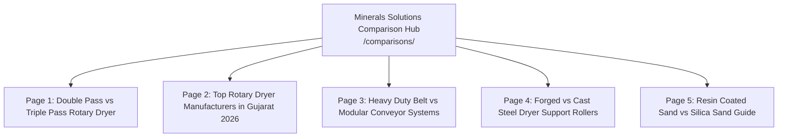

# Competitor Comparison & Alternatives Pages Audit (`seo-competitor-pages`)
**Project:** Minerals Solutions (`mineralssolution.in`)  
**Facility Location:** Zak GIDC, Dahegam, Gandhinagar / Ahmedabad Corridor, Gujarat  
**Author:** Antigravity SEO Intelligence  
**Framework:** `seo-competitor-pages` v2.4.2  
**Date:** November 2026  

---

## 1. Strategic Purpose & Commercial Value

In industrial B2B machinery procurement, technical decision-makers (procurement heads, plant engineers, EPC contractors, and foundry managers) do not immediately purchase on a brand name. They compare:
- **Design Configurations** (e.g., Double-pass vs Single/Triple-pass rotary dryers)
- **Material Metallurgy** (e.g., Forged steel vs Cast steel trunnion support rollers)
- **OEM Capabilities** (e.g., Local Zak GIDC/Ahmedabad fabrication vs out-of-state suppliers)

Creating dedicated **Competitor Comparison ("X vs Y") and Alternatives Pages** allows **Minerals Solutions** to:
1. Capture high-intent, bottom-of-the-funnel (BOFU) search queries where buyers are actively choosing equipment.
2. Position Minerals Solutions as an objective engineering authority, explaining real tradeoffs in thermal efficiency, wear life, and TPH operating costs.
3. Divert organic traffic searching for dominant market leaders (Kiyaan En Fab, Apollo, Piyali, Puzzolana) directly into RFQ conversion funnels.

---

## 2. High-Priority Competitor Comparison Pages (Architecture)

Below are the 5 high-impact comparison and alternatives pages mapped to Minerals Solutions' verified product lines:



---

### Page 1: "Double Pass vs Triple Pass Rotary Dryer: Industrial Efficiency & Footprint Guide"
- **Target URL:** `https://mineralssolution.in/comparisons/double-pass-vs-triple-pass-dryer/`
- **Page Type:** Direct Technical "X vs Y" Comparison
- **Primary Keyword:** `double pass vs triple pass rotary dryer` (Commercial Investigation)
- **Secondary Keywords:** `double pass sand dryer`, `rotary dryer thermal efficiency`, `triple pass drum dryer vs double pass`, `silica sand rotary dryer comparison`
- **Search Intent:** Plant managers deciding on dryer configuration for sand, minerals, sawdust, or biomass.
- **Competitors Addressed:** Kiyaan En Fab Solution (Ahmedabad), Jamuna Engineering (Haryana), Aesha Conveyors (Kathwada).

#### Verified Technical Feature Matrix
| Technical Parameter | Double Pass Rotary Dryer (Minerals Solutions) | Triple Pass Rotary Dryer (Industry Standard) | Single Pass Drum Dryer |
| :--- | :---: | :---: | :---: |
| **Footprint Requirement** | **Compact (40% less than single pass)** | Ultra-compact (50% less) | High (long drum layout) |
| **Thermal Efficiency** | **75% – 85%** | 80% – 88% | 55% – 65% |
| **Moisture Handling Range** | **High (Up to 35% feed moisture)** | Moderate (Up to 25% moisture) | High (Wide tolerance) |
| **Cleaning & Internal Flight Maintenance** | **Easy access between inner & outer shell** | Complex (Difficult to inspect middle drum) | Very easy |
| **Clogging Risk (Sticky Minerals/Clays)** | **Low to Moderate** | High (Inner passes prone to choke) | Very Low |
| **Capital Investment (CAPEX)** | **Moderate / Cost-Effective** | High (Precision multi-shell concentric welding) | Lower initial cost |
| **Ideal Mineral Applications** | **Silica Sand, Quartz, Foundry Sand, River Sand, Biomass** | Dry light sawdust, clean grains, non-abrasive chips | Large aggregate, heavy ore |

#### The Strategic Angle / Verdict:
> *"Triple-pass dryers offer marginally higher thermal insulation but suffer severe downtime when handling abrasive, sticky silica sand due to unserviceable inner drum choke points. Minerals Solutions' engineered Double-Pass design delivers 80%+ thermal efficiency with full maintenance access, making it the superior choice for Gujarat's mineral and silica sand processing plants."*

---

### Page 2: "Top Industrial Rotary Dryer Manufacturers in Gujarat [2026 Comparison]"
- **Target URL:** `https://mineralssolution.in/comparisons/rotary-dryer-manufacturers-gujarat/`
- **Page Type:** Curated Category Roundup & Competitor Alternatives
- **Primary Keyword:** `rotary dryer manufacturer in gujarat`
- **Secondary Keywords:** `rotary dryer manufacturers in ahmedabad`, `industrial sand dryer suppliers gujarat`, `double pass dryer fabricator dahegam`
- **Competitor Landscape Analyzed:**

| Company Name | Location Hub | Core Strength | Limitations / Consideration |
| :--- | :--- | :--- | :--- |
| **Minerals Solutions** | **Zak GIDC, Dahegam (Ahmedabad)** | Custom double-pass dryers, in-house mineral testing, direct engineering support, competitive OEM pricing | Dedicated focus on minerals, sand, and heavy aggregate drying systems |
| **Kiyaan En Fab Solution** | Ahmedabad | Concentric triple-pass systems and standardized catalog | Extended lead times, premium pricing on custom modifications |
| **Aesha Conveyors & Crushing** | Kathwada GIDC, Ahmedabad | Heavy turnkey crushing lines and integrated screening | Primary focus on crushing; rotary dryers are ancillary |
| **New Fab Engineering** | Vatva GIDC, Ahmedabad | General chemical process vessel fabrication | Less specialized in high-volume mineral sand drying |

---

### Page 3: "Heavy-Duty Bulk Belt Conveyors vs Modular Conveyor Systems: Mineral Handling Guide"
- **Target URL:** `https://mineralssolution.in/comparisons/belt-conveyor-vs-modular-conveyor/`
- **Page Type:** Application Selection & "X vs Y"
- **Primary Keyword:** `bulk belt conveyor vs modular conveyor`
- **Secondary Keywords:** `quarry conveyor systems ahmedabad`, `troughing belt conveyor for silica sand`, `conveyor system manufacturer gujarat`
- **Key Focus:** Explaining why plastic modular belts fail in heavy abrasive mineral applications (crushed quartz, copper slag, wet silica sand) and why heavy-duty rubber troughing belts with sealed precision idlers are essential.

---

### Page 4: "Forged Steel vs Cast Steel Dryer Support Rollers: Trunnion Assembly Selection"
- **Target URL:** `https://mineralssolution.in/comparisons/forged-vs-cast-steel-dryer-support-rollers/`
- **Page Type:** Technical Specification Comparison
- **Primary Keyword:** `forged steel vs cast steel dryer support rollers`
- **Secondary Keywords:** `rotary kiln support roller assembly`, `dryer trunnion roller manufacturer ahmedabad`, `crusher plant spares gujarat`
- **Competitors Addressed:** Nishi Enterprise (Ahmedabad), Piyali Group (Ghaziabad).

#### Technical Specifications Breakdown
| Engineering Parameter | Forged Alloy Steel Roller (EN19 / 42CrMo4) | High-Grade Cast Steel Roller (280-520W / ZG35CrMo) |
| :--- | :---: | :---: |
| **Tensile Strength** | 850 – 1000 MPa | 600 – 750 MPa |
| **Internal Porosity / Defect Risk** | Zero (dense forged grain structure) | Requires 100% Ultrasonic Testing (UT) |
| **Wear & Pitting Resistance** | Exceptional (Uniform surface induction hardening) | Good (Prone to localized spalling under shock) |
| **Dynamic Load Capacity** | Up to 120 Tons per trunnion | Up to 60 Tons per trunnion |
| **Minerals Solutions Recommendation** | Heavy rotary dryers > 2.5m diameter & heavy kilns | Standard sand dryers < 2.0m diameter |

---

### Page 5: "Resin Coated Sand (RCS) vs Standard Washed Silica Sand: Foundry Core Making Guide"
- **Target URL:** `https://mineralssolution.in/comparisons/resin-coated-sand-vs-silica-sand/`
- **Page Type:** Material Comparison & Application Guide
- **Primary Keyword:** `resin coated sand vs silica sand`
- **Secondary Keywords:** `RCS sand for shell molding`, `foundry silica sand grades gujarat`, `copper slag vs quartz sand abrasive`
- **Commercial Intent:** Direct procurement for foundry managers in Rajkot, Ahmedabad, Vadodara, and Pune looking for shell molding sand vs green sand casting raw materials.

---

## 3. High-Converting Page Layout Blueprint (The Wireframe)

To maximize conversion from incoming search traffic, every comparison page must follow this 7-step layout:

1. **Above-the-Fold Instant Verdict (Hero Section):**
   - High-contrast H1 (e.g., `Double Pass vs Triple Pass Rotary Dryers: Which Delivers Better ROI for Sand Processing?`).
   - Quick 2-sentence executive summary.
   - Dual CTA: `[Download Engineering Comparison PDF]` & `[Request Technical Sizing Quote]`.
2. **Interactive / Scannable Comparison Matrix:**
   - Visual comparison table featuring green checkmarks, amber warnings, and exact operational parameters (TPH, Thermal %, Footprint).
3. **Deep-Dive Engineering Analysis:**
   - 3–4 sections evaluating: Operating Cost (OPEX), Maintenance Downtime, Abrasive Wear Tolerance, and Fuel Options (Gas / Diesel / Biomass).
4. **Interactive Equipment Sizing Calculator / Quote Widget:**
   - Simple form: Select Material (Silica Sand / Biomass / Slag) → Input Feed Moisture % → Input Required Output TPH → Click `[Get Custom Machine Drawing & Quotation]`.
5. **Direct Manufacturer Trust Signals:**
   - Facility photo at Zak GIDC, Dahegam.
   - Direct consultation callout with **Vipul A. Prajapati (`+91 9106163058`)**.
   - Official RFQ dispatch to **`sales@mineralssolution.in`**.
6. **Transparent Fairness Disclaimer:**
   - Stated objective evaluation criteria complying with advertising standards.
7. **Contextual Internal Linking:**
   - Links to `/products/rotary-dryers/double-pass-dryer/`, `/products/dryer-support-rollers/`, and `/contact/`.

---

## 4. Structured Data Schema Markup (JSON-LD)

Every comparison page must implement structured data so Google SERP can show rich snippets and FAQ drop-downs.

### A. Product Comparison Schema (`Product` with `additionalProperty`)
```json
{
  "@context": "https://schema.org",
  "@type": "Product",
  "name": "Minerals Solutions Double Pass Rotary Dryer",
  "image": "https://mineralssolution.in/images/double-pass-dryer.webp",
  "description": "High-efficiency double pass industrial rotary drum dryer engineered for silica sand, river sand, and mineral processing.",
  "brand": {
    "@type": "Brand",
    "name": "Minerals Solutions"
  },
  "manufacturer": {
    "@type": "Organization",
    "name": "Minerals Solutions",
    "address": {
      "@type": "PostalAddress",
      "streetAddress": "10, Shyam Estate, Zak GIDC, Zak-Vahelal Road, Ta. Dahegam",
      "addressLocality": "Gandhinagar",
      "addressRegion": "Gujarat",
      "postalCode": "382330",
      "addressCountry": "IN"
    }
  },
  "additionalProperty": [
    {
      "@type": "PropertyValue",
      "name": "Thermal Efficiency",
      "value": "75% - 85%"
    },
    {
      "@type": "PropertyValue",
      "name": "Material Capability",
      "value": "Silica Sand, Quartz, Sawdust, Foundry Sand"
    },
    {
      "@type": "PropertyValue",
      "name": "Footprint Reduction",
      "value": "40% compared to single pass"
    }
  ]
}
```

### B. FAQPage Schema for SERP Dropdowns
```json
{
  "@context": "https://schema.org",
  "@type": "FAQPage",
  "mainEntity": [
    {
      "@type": "Question",
      "name": "What is the difference between a double pass and a triple pass rotary dryer?",
      "acceptedAnswer": {
        "@type": "Answer",
        "text": "A double pass dryer utilizes two concentric drums where material travels forward through the inner cylinder and returns through the outer shell. A triple pass dryer uses three cylinders. Double pass dryers are significantly easier to clean and maintain when processing abrasive minerals like silica sand, which can choke the narrow inner flights of triple pass drums."
      }
    },
    {
      "@type": "Question",
      "name": "Where is Minerals Solutions located in Gujarat?",
      "acceptedAnswer": {
        "@type": "Answer",
        "text": "Minerals Solutions' manufacturing facility is located at 10, Shyam Estate, Zak GIDC, Zak-Vahelal Road, Dahegam, Gandhinagar, Gujarat 382330, directly serving the Ahmedabad and North Gujarat industrial belt."
      }
    }
  ]
}
```

---

## 5. Fairness, Accuracy & Anti-Defamation Guidelines

Per the `seo-competitor-pages` discipline:
1. **Verifiable Engineering Data Only:** Never make unsubstantiated claims about competitor build quality. Compare based on published catalog standards, physical laws (thermodynamics, metallurgy), and verifiable industry tolerances.
2. **Acknowledge Competitor Strengths:** For example, openly state that triple-pass dryers have a slightly smaller footprint for lightweight sawdust, while highlighting why double-pass is superior for heavy abrasive sands.
3. **Timely "As Of" Notices:** All technical comparison charts will state: *"Technical data verified as of Q4 2026. Specifications subject to custom engineering parameters."*
4. **Clear Affiliation Disclosure:** Disclose at the bottom of the article: *"This technical guide is authored by Minerals Solutions' engineering team to assist industrial buyers in sizing and procuring processing equipment."*

